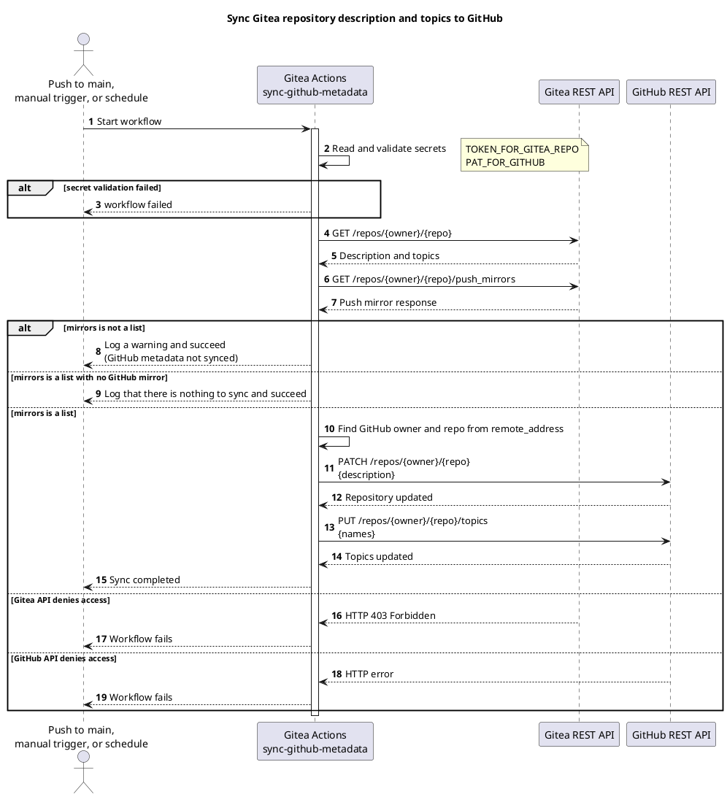
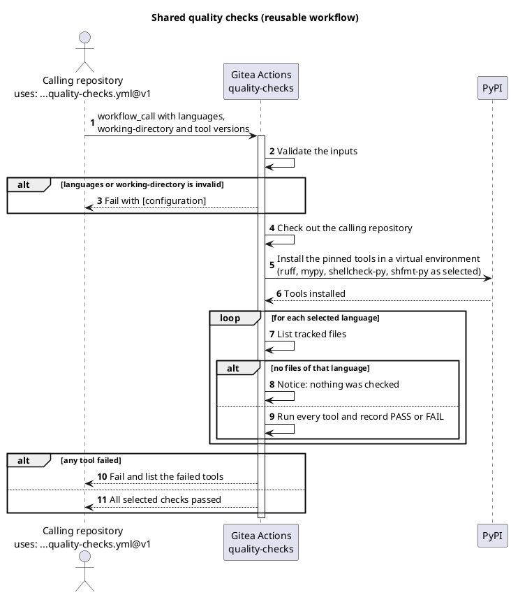
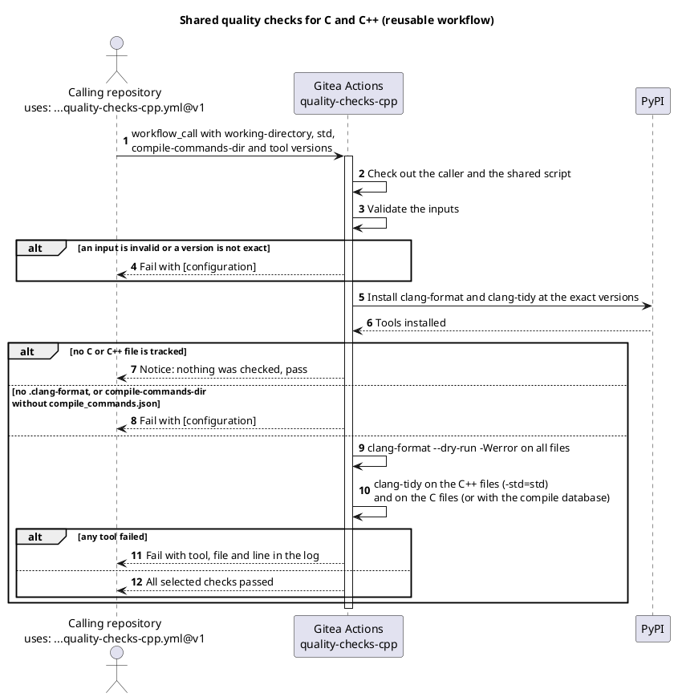
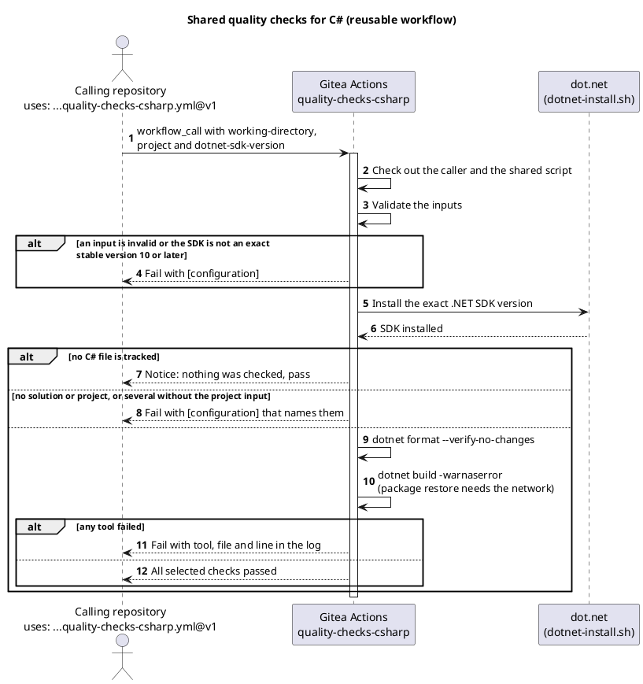
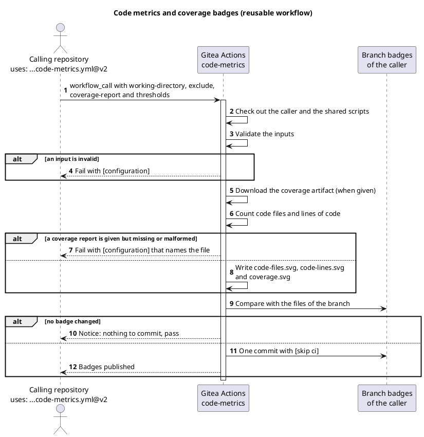
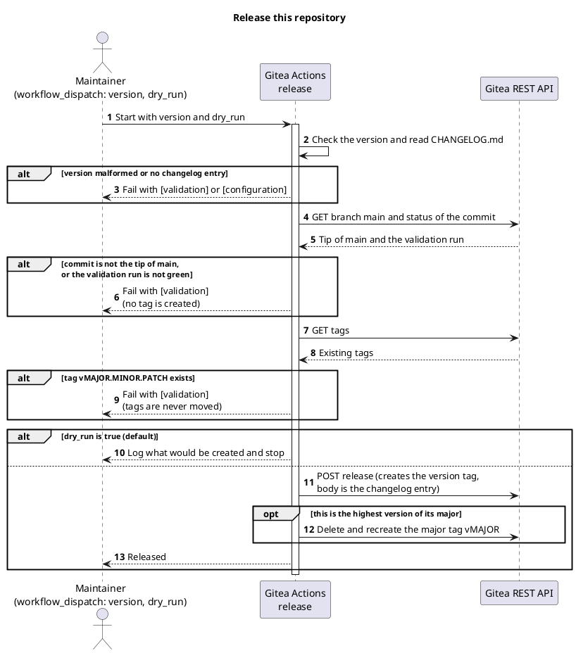
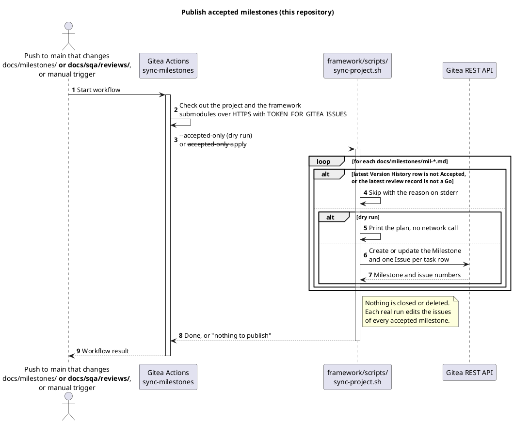
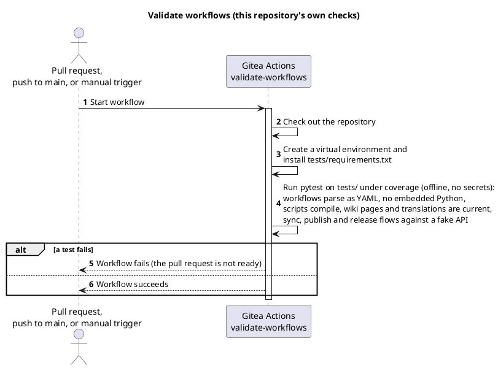

# 🚀 TirSystem GitHub Actions

A collection of reusable Gitea Actions workflows for DevOps professionals and software engineers working on TirSystem projects.

## 📚 Table of Contents

- [Overview](#-overview)
- [Workflows](#-workflows)
- [Requirements](#-requirements)
- [Setup](#-setup)
- [Run](#-run)
- [Tests](#-tests)
- [License](#-license)
- [Links](#-links)

## 🧭 Overview

This repository is the central collection of reusable automation for TirSystem repositories. The primary repository lives at `git.tirsystem.com` (Gitea) and is push-mirrored to GitHub.

It contains ten workflows: metadata sync to the GitHub mirror, wiki publishing (scoped, for every repository with a `docs/wiki/` folder), shared quality checks for Python and shell, for C and C++ and for C#, code metrics and coverage badges, a check that comments are in English, a release workflow, the publishing of accepted milestones and the repository's own validation. They are listed with their purpose and a diagram under [Workflows](#-workflows).

## 🔧 Workflows

When a repository should use each workflow in its SQA and QC is set out in the [adoption rules](guides/adoption-rules.md).

Ten workflows live in this repository. A **scoped** workflow is delivered by the instance to every repository of the TirSystem organizations and needs nothing in the repository; a **reusable** workflow is called by a repository with `uses:`; the others run only here. The diagrams are PlantUML source.

| Workflow | File | Kind | Starts on | Purpose |
| --- | --- | --- | --- | --- |
| Sync GitHub mirror metadata | [`sync-github-metadata.yml`](.gitea/scoped_workflows/sync-github-metadata.yml) | Scoped | push to `main`, manual, daily 03:17 UTC | Copies the description and topics of a Gitea repository to its GitHub push mirror |
| Publish wiki pages | [`publish-wiki-pages.yml`](.gitea/scoped_workflows/publish-wiki-pages.yml) | Scoped | push to `main` that changes `docs/wiki/**`, manual | Publishes the pages in `docs/wiki/` to the wiki of the repository; skipped where the folder does not exist |
| Quality checks | [`quality-checks.yml`](.gitea/workflows/quality-checks.yml) | Reusable (`workflow_call`) | a call from another repository | Runs ruff, mypy, shellcheck and shfmt on the tracked files and changes nothing |
| Quality checks C++ | [`quality-checks-cpp.yml`](.gitea/workflows/quality-checks-cpp.yml) | Reusable (`workflow_call`) | a call from another repository | Runs clang-format and clang-tidy at exact versions on the tracked C and C++ files and changes nothing |
| Quality checks C# | [`quality-checks-csharp.yml`](.gitea/workflows/quality-checks-csharp.yml) | Reusable (`workflow_call`) | a call from another repository | Runs `dotnet format` and `dotnet build` on an exact .NET SDK 10 or later and changes nothing |
| Code metrics | [`code-metrics.yml`](.gitea/workflows/code-metrics.yml) | Reusable (`workflow_call`) | a call from another repository | Counts the code files and the lines of code (without comment and blank lines), reads a Cobertura coverage report and commits three SVG badges to a `badges` branch |
| English comments | [`english-comments.yml`](.gitea/workflows/english-comments.yml) | Reusable (`workflow_call`) | a call from another repository, on a pull request | Judges the language of the comments and docstrings a pull request adds, fails the run when one is not English and writes one comment on the pull request that mentions the author |
| Release | [`release.yml`](.gitea/workflows/release.yml) | This repository only | manual | Creates the version tag, the release page and the major tag after the checks |
| Publish accepted milestones | [`sync-milestones.yml`](.gitea/workflows/sync-milestones.yml) | This repository only | push to `main` that changes `docs/milestones/**` or `docs/sqa/reviews/**`, manual (dry run by default) | Creates or updates the Gitea milestone and issues of every milestone that is Accepted with a Go review |
| Validate workflows | [`validate-workflows.yml`](.gitea/workflows/validate-workflows.yml) | This repository only | pull request, push to `main`, manual | Parses every workflow and runs the offline tests |

### 🔄 Sync GitHub metadata

Syncs the Gitea repository description and topics to the GitHub push mirror.

#### 🕒 Cron

Daily at 03:17 UTC (`17 3 * * *`), plus every push to `main` and manual `workflow_dispatch`.

#### 🔀 Workflow



### ✅ Quality checks

A reusable workflow for Python and shell, called with `uses: TirSystem/git-workflows/.gitea/workflows/quality-checks.yml@v1` (see the [guide](guides/quality-checks.md)).

#### 🔀 Workflow



### 🧱 Quality checks C++

A reusable workflow for C and C++, called with `uses: TirSystem/git-workflows/.gitea/workflows/quality-checks-cpp.yml@v1` (ADR-0008). The repository needs a `.clang-format`; a `.clang-tidy` and a compile database are optional.

#### 🔀 Workflow



### 🟣 Quality checks C#

A reusable workflow for C#, called with `uses: TirSystem/git-workflows/.gitea/workflows/quality-checks-csharp.yml@v1` (ADR-0008). It installs the exact .NET SDK given by `dotnet-sdk-version` (10 or later) and needs the network for the package restore.

#### 🔀 Workflow



### 🏅 Code metrics

A reusable workflow that counts the code files and the lines of code (without comment and blank lines) of a repository and publishes them, with the test coverage, as three SVG badges on a `badges` branch, called with `uses: TirSystem/git-workflows/.gitea/workflows/code-metrics.yml@v2` (ADR-0010). It needs `contents: write` and runs no test: an earlier job of the caller produces a Cobertura XML coverage report and uploads it as an artifact ([guide](guides/code-metrics.md)).

#### 🔀 Workflow



### 🔤 English comments

A reusable workflow that checks that the comments and docstrings a pull request adds are written in English, fails the run when one is not, and writes one comment on the pull request that mentions the author. It changes no file and sends no source text outside the instance; marking the check as required in the branch protection is what blocks the merge ([guide](guides/english-comments.md), ADR-0012).

#### 🔀 Workflow

```plantuml
@startuml
title English comments check (reusable workflow)

autonumber

actor "Pull request
uses: ...english-comments.yml@v2" as Caller
participant "Gitea Actions
english-comments" as Workflow
participant "Gitea REST API" as Gitea

Caller -> Workflow: workflow_call with scope, exclude,
allowed-words-file, threshold and min-words
activate Workflow

Workflow -> Workflow: Check out the full history and the shared scripts
Workflow -> Workflow: Install the pinned language detector
Workflow -> Workflow: Read the comments on the added lines
Workflow -> Workflow: Remove paths, options, identifiers and allowed words
Workflow -> Workflow: Judge the language of each comment block

alt a block is not English
  Workflow -> Gitea: Create or update one comment that mentions the author
  Workflow --> Caller: run failed (the required check blocks the merge)
else all blocks are English
  Workflow -> Gitea: Mark an earlier comment resolved
  Workflow --> Caller: run passed
end

deactivate Workflow
@enduml
```

### 🏷️ Release

Started by hand by a maintainer; with `dry_run` `true` (the default) it only checks (see the [release process](guides/release-process.md)).

#### 🔀 Workflow



### 📖 Publish wiki pages

A scoped workflow: the instance runs it in every repository of the organization, so no call and no marker file is needed. A repository opts in by having a `docs/wiki` folder; where there is none, the run ends without doing anything. It publishes the Markdown pages of `docs/wiki` to the wiki of the repository and keeps the wiki pages that are not in the folder. It needs the organization secret `TOKEN_FOR_GITEA_WIKI`.

#### 🔀 Workflow

```plantuml
@startuml
title Publish docs/wiki to the wiki of the repository

autonumber

actor "Push to main that changes docs/wiki/**,
or manual trigger" as Trigger
participant "Gitea Actions
publish-wiki-pages" as Workflow
participant "shared-scripts
(tools/publish_wiki.py at v2)" as Script
participant "Gitea wiki API" as Wiki

Trigger -> Workflow: Start workflow
activate Workflow
Workflow -> Workflow: Check out the repository

alt docs/wiki does not exist
  Workflow --> Trigger: Nothing to publish
else
  Workflow -> Script: Fetch the script, run it
  activate Script
  alt docs/wiki has no Markdown pages
    Script --> Workflow: Fail with [configuration]
(an empty folder never deletes pages)
  else
    Script -> Script: Read TOKEN_FOR_GITEA_WIKI
    Script -> Wiki: GET repository (preflight)
    Wiki --> Script: Wiki is enabled, token accepted
    Script -> Wiki: GET pages
    Wiki --> Script: Existing pages
    Script -> Wiki: Create new pages, update changed pages
    Script --> Workflow: Log created and updated counts
  end
  deactivate Script
  Workflow --> Trigger: Workflow result
end
deactivate Workflow
@enduml
```

### 📌 Publish accepted milestones

Standing authorization to publish: on a push to `main` that changes the milestones or their reviews, every milestone whose latest Version History row is Accepted and whose latest review is a Go is created or updated on Gitea with its tasks as issues. Nothing is closed or deleted. A manual run is a dry run unless `dry_run` is switched off. It uses the secret `TOKEN_FOR_GITEA_ISSUES` and the `--accepted-only` rule of the mounted framework (v0.5.0 or later).

#### 🔀 Workflow



### 🧪 Validate workflows

The repository's own validation: the offline tests that gate every pull request.

#### 🔀 Workflow



## 📋 Requirements

- A Gitea instance with Actions enabled and a runner providing `ubuntu-latest` with `python3`
- A configured GitHub push mirror on the Gitea repository (at most one; repositories without a mirror are skipped successfully)
- Repository secrets:
  - `TOKEN_FOR_GITEA_REPO`: Gitea API token (the token only, no JSON)
  - `PAT_FOR_GITHUB`: a GitHub personal access token allowed to edit the mirror repository (the token only, no JSON)
  - `TOKEN_FOR_GITEA_WIKI` (only for repositories that publish a wiki, see the [onboarding guide](guides/onboarding.md)): a Gitea token that can write the wiki, stored as a secret of the repository's organization; there is no fallback to `TOKEN_FOR_GITEA_REPO`

## 🛠️ Setup

No dependencies need to be installed; the workflow uses only the Python standard library.

1. Clone the repository:
   ```bash
   git clone ssh://git@git.tirsystem.com:10022/TirSystem/git-workflows.git
   ```
2. Add the secrets listed under [Requirements](#-requirements) to the repository settings in Gitea.
3. Configure the GitHub push mirror in the repository settings.

## ▶️ Run

Workflows run automatically on push to `main` and on the daily schedule. To run manually, trigger **Sync GitHub mirror metadata** via `workflow_dispatch` from the Actions tab in Gitea.

## 🧪 Tests

The workflow files and the scripts in `tools/` are validated by offline tests that need no network access and no secrets:

```bash
python3 -m venv .venv
source .venv/bin/activate        # Windows PowerShell: .venv\Scripts\Activate.ps1
python -m pip install -r tests/requirements.txt
python -m coverage run -m pytest -q tests
python -m coverage report
```

The same checks run on every pull request and push to `main` through [`validate-workflows.yml`](.gitea/workflows/validate-workflows.yml). They parse every workflow as YAML, check that none embeds Python, compile the scripts in `tools/`, require explicit job permissions, and test credential parsing, push mirror address parsing and the sync and publish flows against a fake API. The run fails when the line and branch coverage of `tools/` falls below 95% (`.coveragerc`).

After a change to the sync workflow, also trigger **Sync GitHub mirror metadata** manually in Gitea and compare the description and topics on the GitHub mirror.

## 🟢 Capabilities

Rows that say Implemented or Guides written exist today. The rest is planned and tracked in the [Project Plan](docs/project-plan.md), which also describes each use case.

| Capability | Status |
| --- | --- |
| Synchronize repository metadata (Gitea to GitHub mirror) | Implemented in `.gitea/scoped_workflows/`, with offline tests and a validation workflow |
| Configure and validate workflow credentials | Implemented for the sync workflow: preflight checks both tokens before any change ([guide](guides/credentials.md)) |
| Onboard a repository, manage runners, diagnose failures | Guides written ([onboarding](guides/onboarding.md), [troubleshooting](guides/troubleshooting.md)); scoped delivery to the repositories of all four organizations verified (MIL-002) |
| Publish a repository wiki from `docs/wiki/` through a called workflow | Implemented as the scoped workflow `.gitea/scoped_workflows/publish-wiki-pages.yml`, with offline tests; it runs in every repository that has a `docs/wiki/` folder, and this repository's own wiki is in `docs/wiki/` (MIL-008, MIL-009) |
| Shared quality checks (Python and shell) | Implemented as the reusable workflow `.gitea/workflows/quality-checks.yml`, with offline tests and a trial in a second organization; adopted in RepoFoundry ([guide](guides/quality-checks.md)) |
| Shared quality checks (C and C++, C#) | Implemented as the reusable workflows `.gitea/workflows/quality-checks-cpp.yml` and `.gitea/workflows/quality-checks-csharp.yml` with exact tool versions and offline tests; not yet used in another repository (MIL-007) ([C and C++ guide](guides/quality-checks-cpp.md), [C# guide](guides/quality-checks-csharp.md)) |
| Code metrics and coverage badges | Implemented and released in 2.1.0 as the reusable workflow `.gitea/workflows/code-metrics.yml` with a counter, a Cobertura reader, an SVG renderer and offline tests; tried in a throwaway repository, not yet used in a project repository (MIL-010) ([guide](guides/code-metrics.md)) |
| English comments | Implemented as the reusable workflow `.gitea/workflows/english-comments.yml` with a comment extractor, a language detector measured on a corpus (ADR-0012), a pull request comment and offline tests; not yet run on the instance or required by any repository (MIL-013) ([guide](guides/english-comments.md)) |
| Versioned release and publishing | Release process, changelog and upgrade guide defined; the release workflow exists and `v1.0.0` is released (MIL-004) ([guide](guides/upgrading.md)) |

## 📄 License

Licensed under the GNU Affero General Public License v3.0 (AGPL-3.0). See [LICENSE](LICENSE).

## 🔗 Links

- [Repository](https://git.tirsystem.com/TirSystem/git-workflows)
- [Documentation](https://git.tirsystem.com/TirSystem/git-workflows#readme)
- [Issue tracker](https://git.tirsystem.com/TirSystem/git-workflows/issues)
