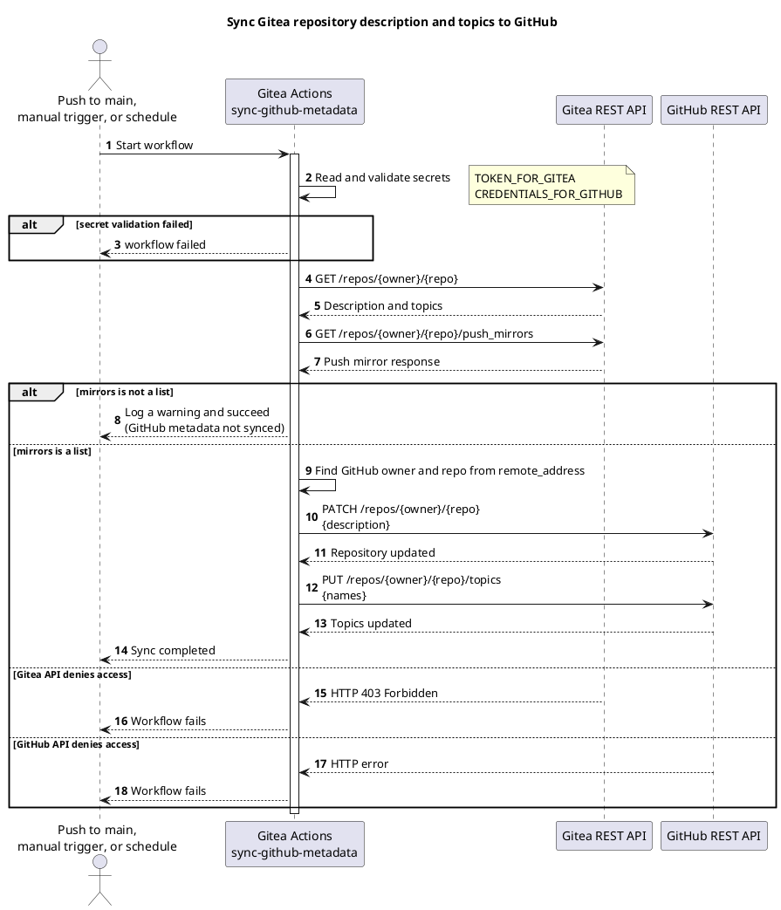

# 🚀 TirSystem GitHub Actions

A collection of reusable Gitea Actions workflows for DevOps professionals and software engineers working on TirSystem projects.

## 📚 Table of Contents

- [Overview](#-overview)
- [Requirements](#-requirements)
- [Setup](#-setup)
- [Run](#-run)
- [Tests](#-tests)
- [License](#-license)
- [Links](#-links)

## 🧭 Overview

This repository is the central collection of reusable automation for TirSystem repositories. The primary repository lives at `git.tirsystem.com` (Gitea) and is push-mirrored to GitHub.

It currently contains the Gitea workflow [`sync-github-metadata.yml`](.gitea/scoped_workflows/sync-github-metadata.yml), which copies the repository description and topics from Gitea to the GitHub mirror on every push to `main`, on manual dispatch, and daily at 03:17 UTC.

## 📋 Requirements

- A Gitea instance with Actions enabled and a runner providing `ubuntu-latest` with `python3`
- A configured GitHub push mirror on the Gitea repository (exactly one)
- Repository secrets:
  - `TOKEN_FOR_GITEA`: Gitea API token (plain string, or JSON with `GITEA_TOKEN`)
  - `CREDENTIALS_FOR_GITHUB`: JSON object containing `GITHUB_PAT`, a GitHub personal access token allowed to edit the mirror repository

## 🛠️ Setup

No dependencies need to be installed; the workflow uses only the Python standard library.

1. Clone the repository:
   ```bash
   git clone ssh://git@git.tirsystem.com:10022/TirSystem/github-action.git
   ```
2. Add the secrets listed under [Requirements](#-requirements) to the repository settings in Gitea.
3. Configure the GitHub push mirror in the repository settings.

## ▶️ Run

Workflows run automatically on push to `main` and on the daily schedule. To run manually, trigger **Sync GitHub mirror metadata** via `workflow_dispatch` from the Actions tab in Gitea.

## 🧪 Tests

The workflow files and the Python embedded in them are validated by offline tests that need no network access and no secrets:

```bash
python3 -m venv .venv
source .venv/bin/activate        # Windows PowerShell: .venv\Scripts\Activate.ps1
python -m pip install -r tests/requirements.txt
python -m pytest -q tests
```

The same checks run on every pull request and push to `main` through [`validate-workflows.yml`](.gitea/workflows/validate-workflows.yml). They parse every workflow as YAML, compile the embedded Python, require explicit job permissions, and test credential parsing, push mirror address parsing and the sync flow against a fake API.

After a change to the sync workflow, also trigger **Sync GitHub mirror metadata** manually in Gitea and compare the description and topics on the GitHub mirror.

## 🟢 Capabilities

Only the first row is implemented. The rest is planned and tracked in the [Project Plan](docs/project-plan.md), which also describes each use case.

| Capability | Status |
| --- | --- |
| Synchronize repository metadata (Gitea to GitHub mirror) | Implemented in `.gitea/scoped_workflows/`, with offline tests and a validation workflow |
| Configure and validate workflow credentials | Partial: secrets are checked for format only |
| Onboard a repository, manage runners, diagnose failures | Planned (MIL-002) |
| Shared quality checks | Planned (MIL-003) |
| Versioned release and publishing | Planned (MIL-004) |

### 🔄 Sync GitHub metadata

Syncs the Gitea repository description and topics to the GitHub push mirror.

#### 🕒 Cron

Daily at 03:17 UTC (`17 3 * * *`), plus every push to `main` and manual `workflow_dispatch`.

#### 🔀 Workflow



## 📄 License

Licensed under the GNU Affero General Public License v3.0 (AGPL-3.0). See [LICENSE](LICENSE).

## 🔗 Links

- [Repository](https://git.tirsystem.com/TirSystem/github-action)
- [Documentation](https://git.tirsystem.com/TirSystem/github-action#readme)
- [Issue tracker](https://git.tirsystem.com/TirSystem/github-action/issues)
