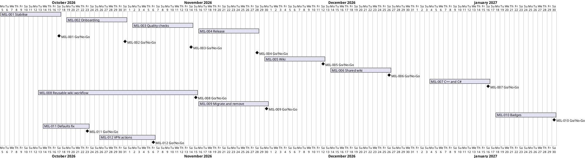

# Project Plan: TirSystem Reusable Workflows

## Metadata
| Key | Value |
| --- | --- |
| ID | PP-001 |
| CrossReference | [BC-001], [SA-001], [ADR-0002], [US-001], [MIL-001], [MIL-002], [MIL-003], [MIL-004], [MIL-005], [MIL-006], [MIL-007], [MIL-008], [MIL-009], [MIL-010], [MIL-011], [MIL-012] |

## Version History
| Date | Status | Author | Reviewer | Change | Commit |
| --- | --- | --- | --- | --- | --- |
| 2026-10-14 | Deprecated | Jens Tirsvad Nielsen | S01 | Added MIL-011 (fix the defaults of the code metrics workflow); reviewed (RC-076), accepted by the author in chat as stand-in for S01 | [02e3794] |
| 2026-10-19 | Accepted | Jens Tirsvad Nielsen | S01 | Added MIL-012 (VPN actions for deployment); reviewed (RC-080), accepted by the author in chat as stand-in for S01 | pending |

---

## Purpose

This plan schedules twelve milestones that move the repository from one
workflow with known defects to a documented, versioned collection of shared
workflows. The Business Case sets no deadline, so the dates are the plan's own; they were confirmed on 2026-10-10 by S01, standing in for S05 (ADR-0002).

## Planning Assumptions

- Week 1 starts 2026-10-05; phases are two weeks long; the last decision is 2026-12-26; MIL-007 follows in January 2027 (2027-01-04 to 2027-01-16, confirmed on 2026-10-11 by S01). MIL-008 amends the shared wiki publishing of MIL-006 and runs in parallel with the October and November windows: its work started on 2026-10-13 and its decision date is its own Target Date, 2026-11-15. MIL-009 follows MIL-008 and runs from 2026-11-16 to its proposed Target Date, 2026-11-30, confirmed by S01 in chat on 2026-10-14. MIL-010 (code metrics and coverage badges) follows MIL-007 in January 2027, from 2027-01-18 to its Target Date, 2027-01-30, accepted by the user in chat on 2026-10-14.
- MIL-012 (VPN actions for deployment) runs from 2026-10-26 to its Target Date, 2026-11-06, proposed by the author and accepted by S01 in chat on 2026-10-19; it overlaps MIL-002 and MIL-003, which do not touch the runners' network.
- Work on a milestone starts only after its `MIL-*` document is `Accepted`.
- Dates were confirmed on 2026-10-10 by S01, standing in for S05 (ADR-0002).

## Gateway Schedule

| Gateway | Document | Window | Decision date | Owner | Stories | Main deliverable | Milestone |
| --- | --- | --- | --- | --- | --- | --- | --- |
| Stabilise the metadata sync | [MIL-001] | 2026-10-05 to 2026-10-17 | 2026-10-17 | S05 | None yet | Single tested workflow, accurate README | [Milestone MIL-001] |
| Onboarding and operations guide | [MIL-002] | 2026-10-19 to 2026-10-31 | 2026-10-31 | S05 | None yet | Verified onboarding, credential and diagnosis guide | [Milestone MIL-002] |
| Shared quality checks | [MIL-003] | 2026-11-02 to 2026-11-14 | 2026-11-14 | S05 | None yet | Reusable quality-check workflow | [Milestone MIL-003] |
| Versioned release and publishing | [MIL-004] | 2026-11-16 to 2026-11-28 | 2026-11-28 | S05 | None yet | Release process and reusable release workflow | [Milestone MIL-004] |
| Wiki and translations | [MIL-005] | 2026-11-30 to 2026-12-12 | 2026-12-12 | S05 | None yet | Wiki pages in English, Danish and Bahasa Malaysia, kept current by every pull request | [Milestone MIL-005] |
| Shared wiki publishing | [MIL-006] | 2026-12-14 to 2026-12-26 | 2026-12-26 | S05 | None yet | Scoped publish-wiki workflow with opt-in, piloted in one other repository | [Milestone MIL-006] |
| Quality checks for C++ and C# | [MIL-007] | 2027-01-04 to 2027-01-16 | 2027-01-16 | S05 | US-001.09, US-001.10 (to extend) | Reusable quality-check workflows for C++ and C#, released | [Milestone MIL-007] |
| Wiki publishing as a reusable workflow | [MIL-008] | 2026-10-13 to 2026-11-15 | 2026-11-15 | S05 | None yet | Reusable publish-wiki-pages workflow, wiki in docs/wiki, scoped workflow deprecated, released as 1.2.2 | [Milestone MIL-008] |
| Migrate the wiki callers and remove the scoped workflow | [MIL-009] | 2026-11-16 to 2026-11-30 | 2026-11-30 | S05 | None yet | Seven repositories publish through a caller, scoped workflow removed, ADR-0004 superseded, released as 2.0.0 | Not created yet (the sync creates it when MIL-009 is Accepted) |
| Code metrics and coverage badges | [MIL-010] | 2027-01-18 to 2027-01-30 | 2027-01-30 | S05 | None yet (task 1 writes them) | Reusable workflow that counts code files and lines of code, reads coverage and commits SVG badges, released | Not created yet (the sync creates it when MIL-010 is Accepted) |
| Fix the defaults of the code metrics workflow | [MIL-011] | 2026-10-14 to 2026-10-23 | 2026-10-23 | S05 | None (technical tasks) | Patch release 2.1.1: the default `tools-ref` of every reusable workflow names a tag that holds its scripts, a test for it, guides and wiki at `@v2`, the framework Badges page without the workaround | Not created yet (the sync creates it when MIL-011 is Accepted) |
| VPN actions for deployment | [MIL-012] | 2026-10-26 to 2026-11-06 | 2026-11-06 | S05 | None (technical tasks) | Release 2.2.0: composite actions `connect-wireguard` and `connect-tailscale` verified on a runner of the instance, with guides, wiki in three languages and the framework templates pinned to the release | Not created yet (the sync creates it when MIL-012 is Accepted) |



## Scope Coverage

| Business Case scope item | Gateway |
| --- | --- |
| Validation of workflow files and their documentation | [MIL-001] |
| Documentation for DevOps professionals | [MIL-002] |
| Gitea Actions workflows for software engineers (quality checks) | [MIL-003] |
| Gitea Actions workflows for software engineers (release and publishing) | [MIL-004] |
| Wiki pages in English, Danish and Bahasa Malaysia | [MIL-005] |
| The wiki publisher shared with other repositories through scoped delivery | [MIL-006] |
| Gitea Actions workflows for software engineers (quality checks for C++ and C#) | [MIL-007] |
| The wiki publisher as a workflow that repositories call, from docs/wiki | [MIL-008] |
| Moving every publishing repository to the called workflow and removing the scoped one | [MIL-009] |
| A shared workflow for code metrics and coverage badges | [MIL-010], [MIL-011] |
| Shared composite actions that connect a deployment job to a private network through WireGuard or Tailscale | [MIL-012] |

## Dependencies

```
MIL-001 → MIL-002 → MIL-003 → MIL-004
            MIL-002 → MIL-005 → MIL-006
   MIL-003 + MIL-004 → MIL-007
                      MIL-006 → MIL-008 → MIL-009
   MIL-003 + MIL-004 → MIL-010 → MIL-011
   MIL-004 + MIL-011 → MIL-012
```

A No-Go moves every later window by the rework time of the failed milestone.

## Plan Risks

| Risk | Impact | Mitigation |
| --- | --- | --- |
| The runner cannot provide the C++ or C# tools (MIL-007) | The workflows need a custom runner image or a longer install | MIL-007 task 2 verifies it first; the ADR of task 3 says what a build-dependent check needs from the caller. |
| Reusable workflow support is missing on the instance | MIL-003 and MIL-004 change shape | Verify first in each milestone (MIL-002 task 2, MIL-003 task 1); fall back to copied templates. |
| Eight repositories still publish through the scoped workflow that MIL-008 deprecates (MIL-008 task 5) | Removing it would stop their wikis | It is deprecated and kept; a follow-up milestone migrates them and removes it in a major release (RC-061). |
| An organisation has no `TOKEN_FOR_GITEA_WIKI` secret, or a repository fails its first run (MIL-009 tasks 3 and 4) | The wiki of that repository stops updating | MIL-009 task 5 reads each wiki back after the first run; the scoped workflow is removed only after every repository passes. |
| The token of a run cannot push to a `badges` branch, or the SVG does not render on the mirror (MIL-010) | The delivery of the badges changes shape | MIL-010 task 3 verifies it first; fall back to a badge file in a path of the default branch or to a run artifact. |
| The runner cannot give a job `NET_ADMIN` and `/dev/net/tun`, or `tailscaled` does not survive to the next step (MIL-012) | The actions need another shape (a different start of the daemon, or userspace mode only) | MIL-012 tasks 2 to 4 verify it first on a runner of the instance; the release waits for criteria 2 and 3. |
| Security review by S05 is a bottleneck | Milestone decisions slip | Keep milestones small and plan review time before each decision date. |

## Open Issues

- No QC checklist exists for the Project Plan.
- The P1 candidates are written as brief use cases (UC-001 to UC-004) with a use case diagram (UCD-001) and user stories (US-001). The P2 and P3 candidates have no use case document yet.

## Appendix: Use Case Candidates and Prioritisation

This appendix evaluates the candidate use cases against the repository as it
is today. It is analysis, not a use case document; formal use cases follow in
MIL-002 task 1. Priority: P1 do first, P2 next, P3 later.

**Recommended order:** (1) Synchronize repository metadata, because it is
the only implemented capability and has a defect, (2) Configure workflow
credentials, (3) Onboard a repository, (4) Diagnose a failed workflow, then
(5) Run project quality checks and (6) Release a reusable workflow. The first
four make the existing workflow dependable and adoptable; the others add new
workflows and only pay off once adoption works.

Current repository state used for the status column: one workflow
(`sync-github-metadata`), one manual probe script (`tests/test_.ps1`), no CI,
no tests, no release process.

| # | Use case | Actor | Priority | Status today |
| --- | --- | --- | --- | --- |
| 1 | Synchronize repository metadata | DevOps professional (S05) | P1 | Implemented in `.gitea/scoped_workflows/`; script has a syntax error |
| 2 | Configure workflow credentials | DevOps professional (S05, S03) | P1 | Partial: secrets are format-checked only |
| 3 | Onboard a repository to standard workflows | DevOps professional (S05) | P1 | Not documented; scoped workflow support unverified |
| 4 | Diagnose a failed workflow | DevOps professional (S05, S03) | P1 | Partial: errors are messages only, uncategorized |
| 5 | Run project quality checks | Software engineer (S02) | P2 | Planned |
| 6 | Release a reusable workflow | DevOps professional (S05) | P2 | Planned |
| 7 | Manage workflow runners | DevOps professional (S03, S05) | P2 | Partial: only `ubuntu-latest` with `python3` assumed |
| 8 | Consume a workflow update | Software engineer (S02) | P2 | Planned; needs versioning |
| 9 | Review workflow results | Software engineer (S02) | P3 | Gitea provides logs; guidance planned |
| 10 | Create a project workflow | Software engineer (S02) | P3 | Planned; needs MIL-003 |
| 11 | Build and publish an artifact | Software engineer (S02) | P3 | Planned; destination undecided |
| 12 | Publish a release | Software engineer (S02) | P3 | Planned; overlaps with use case 6 and 11 |

### UC candidate 1: Synchronize repository metadata (P1)

- **Actor:** DevOps professional. **Goal:** the GitHub mirror shows the Gitea description and topics.
- **Trigger:** push to `main`, manual dispatch, or daily at 03:17 UTC.
- **Preconditions:** both secrets set; at most one GitHub push mirror configured (none: the run is skipped successfully); runner available.
- **Success:** description and topics on GitHub equal those on Gitea.
- **Main flow:** the workflow validates the secrets, reads description and topics from Gitea, finds the GitHub mirror (if none, ends successfully without syncing), updates the description, replaces the topics.
- **Alternatives and failures:** missing or invalid secret: fail with a message; no GitHub mirror: successful run, nothing synced; several GitHub mirrors: fail; non-list mirror response: behavior undecided (MIL-001 task 1); Gitea or GitHub API error: fail with the HTTP code.
- **Dependencies:** none.

### UC candidate 2: Configure workflow credentials (P1)

- **Actor:** DevOps professional. **Goal:** least-privilege tokens that a workflow accepts.
- **Trigger:** onboarding a repository or rotating a token.
- **Preconditions:** access to Gitea and GitHub settings.
- **Success:** a workflow run passes credential checks with the documented minimum permissions.
- **Main flow:** create the tokens, store `TOKEN_FOR_GITEA` and `PAT_FOR_GITHUB`, run the workflow, read the validation result.
- **Alternatives and failures:** empty value, wrong or expired token (rejected with HTTP 401), missing permission: the check names the category without printing the secret.
- **Dependencies:** use case 1.

### UC candidate 3: Onboard a repository to standard workflows (P1)

- **Actor:** DevOps professional. **Goal:** a repository consumes the shared workflows.
- **Trigger:** a new or existing repository needs standard automation.
- **Preconditions:** Actions enabled; runner available; secrets possible to set.
- **Success:** the first run in the repository passes using only the guide.
- **Main flow:** choose scoped or copied delivery, set secrets, configure the push mirror, trigger a run.
- **Alternatives and failures:** scoped workflows unsupported: use a copied template; no runner: see use case 7.
- **Dependencies:** use cases 1 and 2; verification of scoped workflow support.

### UC candidate 4: Diagnose a failed workflow (P1)

- **Actor:** DevOps professional. **Goal:** find the cause of a failed run.
- **Trigger:** a failed or missing run.
- **Preconditions:** access to the run log.
- **Success:** the cause is placed in one category: configuration, credentials, permissions, API response or runner.
- **Main flow:** open the log, read the categorized message, look up the category in the guide, apply the fix, re-run.
- **Alternatives and failures:** no run starts: check runner and trigger; message uncategorized: raise as a defect.
- **Dependencies:** use cases 1 and 2.

### UC candidate 5: Run project quality checks (P2)

- **Actor:** software engineer. **Goal:** tests, lint, format and type checks run on every change.
- **Trigger:** pull request or push.
- **Preconditions:** shared workflow available; project onboarded.
- **Success:** a status check reports pass or fail.
- **Main flow:** the shared workflow detects inputs, runs the checks, reports the result.
- **Alternatives and failures:** a check fails: the log names tool, file and message; unsupported language: workflow fails with a clear message.
- **Dependencies:** use case 3; reusable workflow support.

### UC candidate 6: Release a reusable workflow (P2)

- **Actor:** DevOps professional. **Goal:** a validated, versioned workflow update that consumers can pin.
- **Trigger:** a workflow change is ready.
- **Preconditions:** validation checks exist; version scheme defined.
- **Success:** a tag and changelog entry exist and pinned consumers are unaffected.
- **Main flow:** run validation, update the changelog, tag, announce.
- **Alternatives and failures:** validation fails: no tag; breaking change: new major version.
- **Dependencies:** use case 1 (validation from MIL-001).

### UC candidate 7: Manage workflow runners (P2)

- **Actor:** DevOps professional (runner operator). **Goal:** workflows run on a supported runner.
- **Trigger:** a job waits, fails to start, or a new label is needed.
- **Preconditions:** access to the runner list.
- **Success:** a runner with the required label and tools is online.
- **Main flow:** compare the workflow's `runs-on` label with online runners, check prerequisites such as `python3`, fix or register a runner.
- **Alternatives and failures:** runner offline: restart or replace; label missing: add the label or change the workflow.
- **Dependencies:** use case 3.

### UC candidate 8: Consume a workflow update (P2)

- **Actor:** software engineer. **Goal:** adopt a new workflow version safely.
- **Trigger:** a new release or a changelog notice.
- **Preconditions:** releases are versioned and have a changelog.
- **Success:** the project uses the new version and its pipeline still passes.
- **Main flow:** read the changelog, change the pinned version in one branch, run, merge.
- **Alternatives and failures:** breaking change: follow upgrade notes; failure: roll back to the previous pin.
- **Dependencies:** use case 6.

### UC candidate 9: Review workflow results (P3)

- **Actor:** software engineer. **Goal:** understand a failed check and make it pass.
- **Trigger:** a failed status check on a pull request.
- **Preconditions:** a run exists.
- **Success:** the next run passes.
- **Main flow:** open the check, read the failing step, fix locally, push.
- **Alternatives and failures:** the cause is infrastructure, not code: hand over to use case 4.
- **Dependencies:** use case 5.

### UC candidate 10: Create a project workflow (P3)

- **Actor:** software engineer. **Goal:** compose shared workflows into a project pipeline.
- **Trigger:** a project needs build and delivery steps.
- **Preconditions:** shared workflows are documented with inputs.
- **Success:** the project workflow runs the chosen shared workflows in order.
- **Main flow:** pick workflows, set inputs, set triggers and permissions, test.
- **Alternatives and failures:** missing input: the workflow fails with the input name.
- **Dependencies:** use cases 5 and 8.

### UC candidate 11: Build and publish an artifact (P3)

- **Actor:** software engineer. **Goal:** a package or binary is built and published.
- **Trigger:** a tag or a manual run.
- **Preconditions:** destination decided; token with write access.
- **Success:** the artifact is available at the destination with a version.
- **Main flow:** build, test, package, publish, report the location.
- **Alternatives and failures:** publish denied: permission failure; version exists: fail without overwrite.
- **Dependencies:** use cases 5 and 6; destination decision (MIL-004 task 4).

### UC candidate 12: Publish a release (P3)

- **Actor:** software engineer. **Goal:** a release with validated version and notes.
- **Trigger:** a version tag.
- **Preconditions:** changelog entry exists.
- **Success:** a release page with notes from the changelog.
- **Main flow:** validate the version, build notes, create the release.
- **Alternatives and failures:** invalid version or missing notes: fail. This overlaps with use cases 6 and 11 and should be merged with one of them when the use cases are written.
- **Dependencies:** use cases 6 and 11.

---

[BC-001]: ./business-case.md
[SA-001]: ./stakeholder-analysis.md
[US-001]: ./user-stories.md
[ADR-0002]: ./adr/adr-0002-s01-approves-as-stand-in.md
[MIL-001]: ./milestones/mil-001-stabilise-metadata-sync.md
[MIL-002]: ./milestones/mil-002-onboarding-and-operations.md
[MIL-003]: ./milestones/mil-003-quality-checks.md
[MIL-004]: ./milestones/mil-004-versioned-release.md
[MIL-005]: ./milestones/mil-005-wiki-and-translations.md
[MIL-006]: ./milestones/mil-006-shared-wiki-publishing.md
[MIL-007]: ./milestones/mil-007-cpp-csharp-quality-checks.md
[MIL-008]: ./milestones/mil-008-wiki-reusable-workflow.md
[MIL-009]: ./milestones/mil-009-migrate-wiki-callers-and-remove-scoped-workflow.md
[MIL-010]: ./milestones/mil-010-code-metrics-badges.md
[MIL-011]: ./milestones/mil-011-code-metrics-default-tools-ref.md
[MIL-012]: ./milestones/mil-012-vpn-actions-for-deployment.md
[Milestone MIL-001]: https://git.tirsystem.com/TirSystem/github-action/milestone/18
[Milestone MIL-002]: https://git.tirsystem.com/TirSystem/github-action/milestone/19
[Milestone MIL-003]: https://git.tirsystem.com/TirSystem/github-action/milestone/20
[Milestone MIL-004]: https://git.tirsystem.com/TirSystem/github-action/milestone/21
[Milestone MIL-005]: https://git.tirsystem.com/TirSystem/github-action/milestone/93
[Milestone MIL-006]: https://git.tirsystem.com/TirSystem/github-action/milestone/94
[Milestone MIL-007]: https://git.tirsystem.com/TirSystem/github-action/milestone/95
[Milestone MIL-008]: https://git.tirsystem.com/TirSystem/github-action/milestone/152
[b74ee0e]: https://git.tirsystem.com/TirSystem/github-action/commit/b74ee0e5cfd04f25ba5f2c1addc80699147c479a
[2f267df]: https://git.tirsystem.com/TirSystem/github-action/commit/2f267df2a270087cb7dc482af4ce4f4341e97b03
[02e3794]: https://git.tirsystem.com/TirSystem/github-action/commit/02e3794d7b05799af2544ca303c99271da788e82
