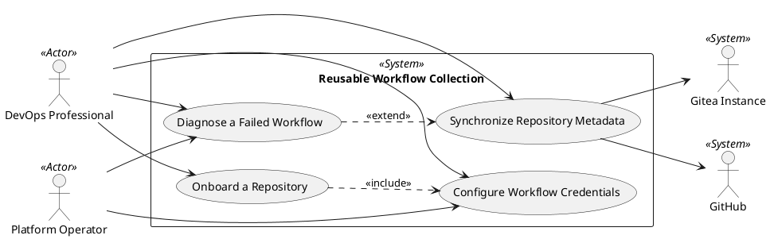

# Use Case Diagram

## Metadata
| Key | Value |
| --- | --- |
| ID | UCD-001 |
| CrossReference | [SA-001], [BC-001], [US-001], [UC-001], [UC-002], [UC-003], [UC-004] |

## Version History
| Date | Status | Author | Reviewer | Change | Commit |
| --- | --- | --- | --- | --- | --- |
| 2026-10-10 | Accepted | Jens Tirsvad Nielsen | S01 | Initial version | [a2bf2d4] |

---

## Purpose and Scope

The boundary is the reusable workflow collection of this repository: the
Gitea Actions workflows, their credential checks and the guides that go with
them. Inside it are the four P1 goals of the Project Plan: keeping the GitHub
mirror's description and topics equal to Gitea's, configuring the credentials
a workflow needs, bringing a repository onto the shared workflows, and finding
the cause of a failed run. Gitea and GitHub are outside the boundary and are
shown as external systems. Quality checks and releases (P2) and the software
engineer's use cases (P2, P3) are not drawn yet.

## Diagram

## Actor Table

| Actor | Stereotype | Stakeholder ID (SA) | Goals (use cases) |
| --- | --- | --- | --- |
| DevOps Professional | `<<Actor>>` | S05 | Synchronize Repository Metadata, Configure Workflow Credentials, Onboard a Repository, Diagnose a Failed Workflow |
| Platform Operator | `<<Actor>>` | S03 | Configure Workflow Credentials, Diagnose a Failed Workflow |
| Gitea Instance | `<<System>>` | - | Synchronize Repository Metadata (source of description and topics) |
| GitHub | `<<System>>` | S04 (audience of the mirror) | Synchronize Repository Metadata (target) |

## Use Case Table

| Use Case | Actor(s) | Goal |
| --- | --- | --- |
| Synchronize Repository Metadata | DevOps Professional | The GitHub mirror shows the Gitea description and topics |
| Configure Workflow Credentials | DevOps Professional, Platform Operator | Least-privilege tokens that a workflow accepts |
| Onboard a Repository | DevOps Professional | A repository consumes the shared workflows |
| Diagnose a Failed Workflow | DevOps Professional, Platform Operator | The cause of a failed run is found and placed in a category |

## Relationships

| Relationship | Justification |
| --- | --- |
| Onboard a Repository `<<include>>` Configure Workflow Credentials | Every onboarding needs working credentials; the behaviour is always part of it and is also used on its own when a token is rotated. |
| Diagnose a Failed Workflow `<<extend>>` Synchronize Repository Metadata | The extension applies only when a run of the synchronization has failed; the synchronization is complete without it. |

---

[SA-001]: ./stakeholder-analysis.md
[BC-001]: ./business-case.md
[US-001]: ./user-stories.md
[UC-001]: ./uc-001/uc.md
[UC-002]: ./uc-002/uc.md
[UC-003]: ./uc-003/uc.md
[UC-004]: ./uc-004/uc.md
[a2bf2d4]: https://git.tirsystem.com/TirSystem/github-action/commit/a2bf2d420416f7aff2badc6fe32a7690e2e523fd
