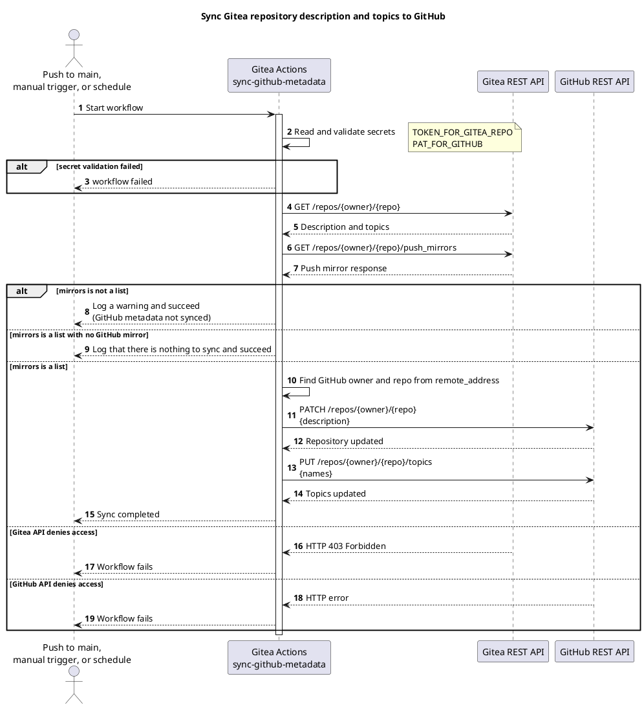
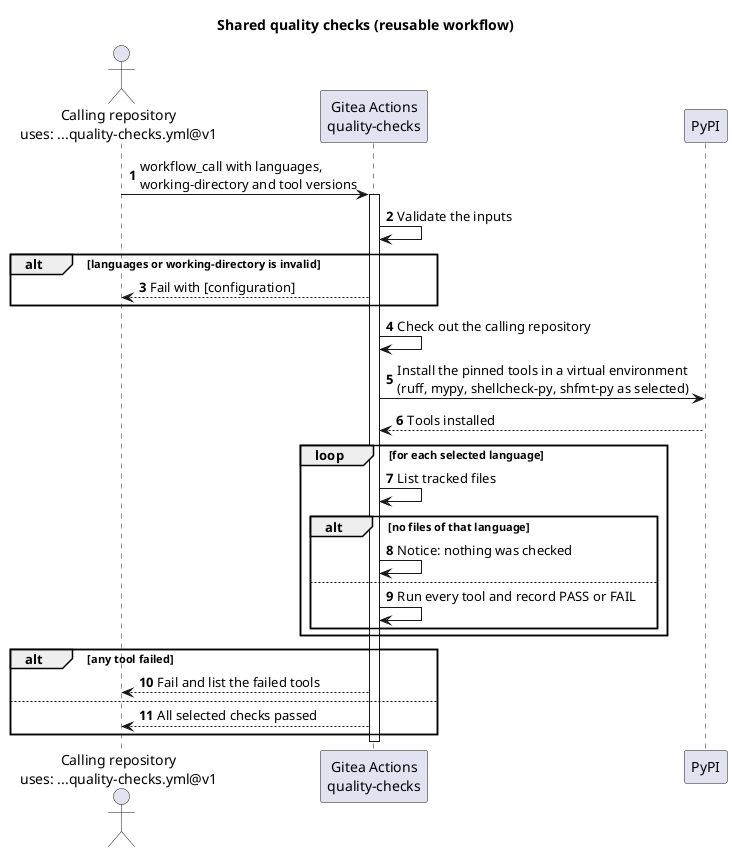
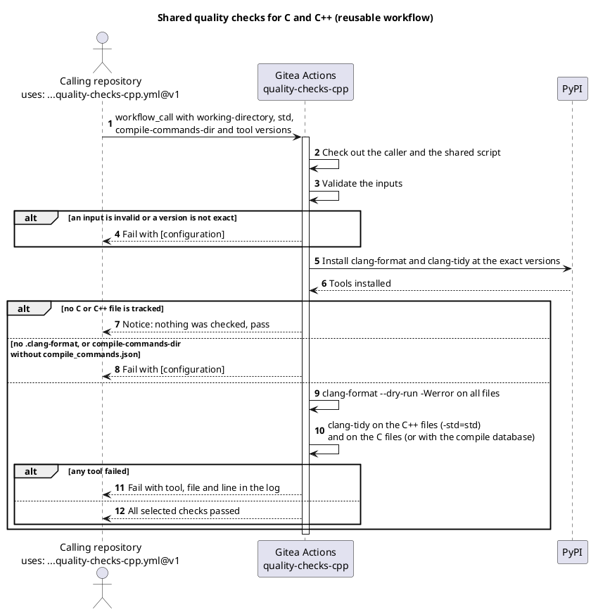
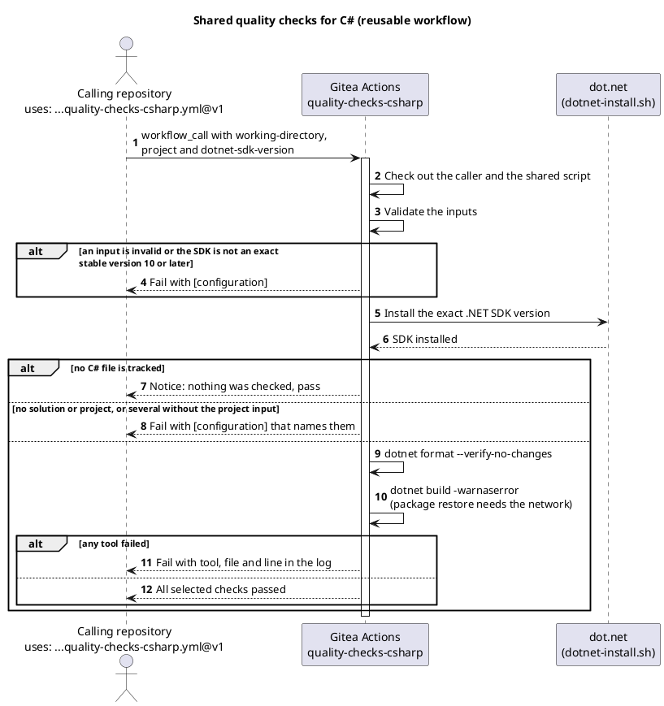
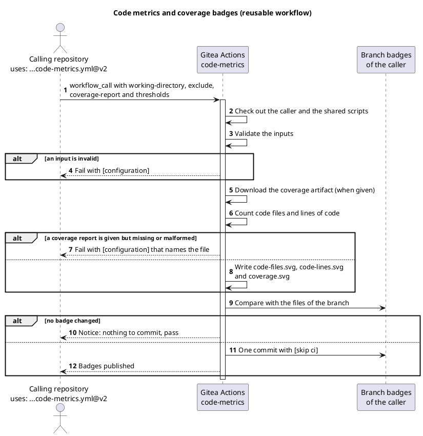
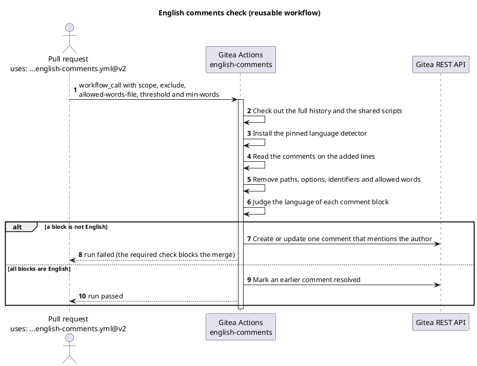
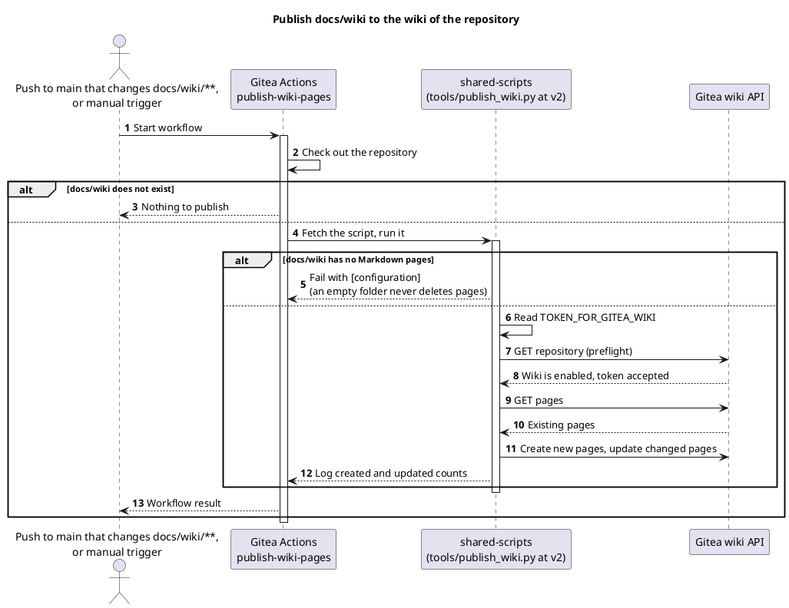
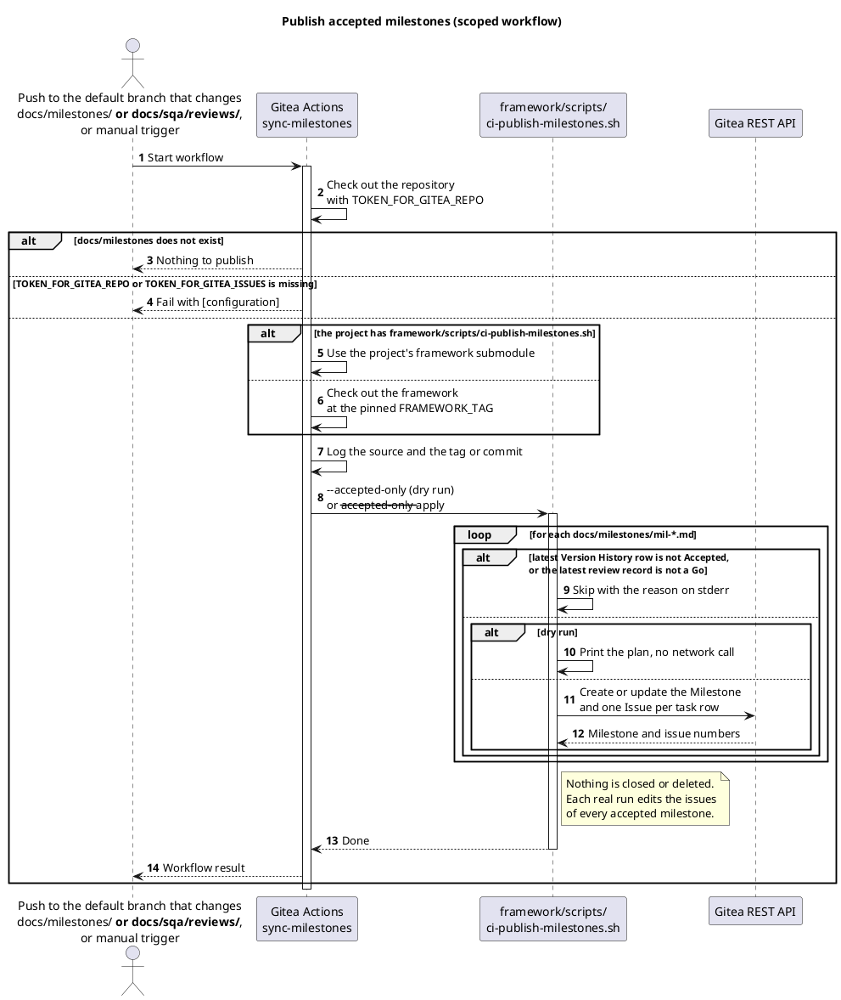
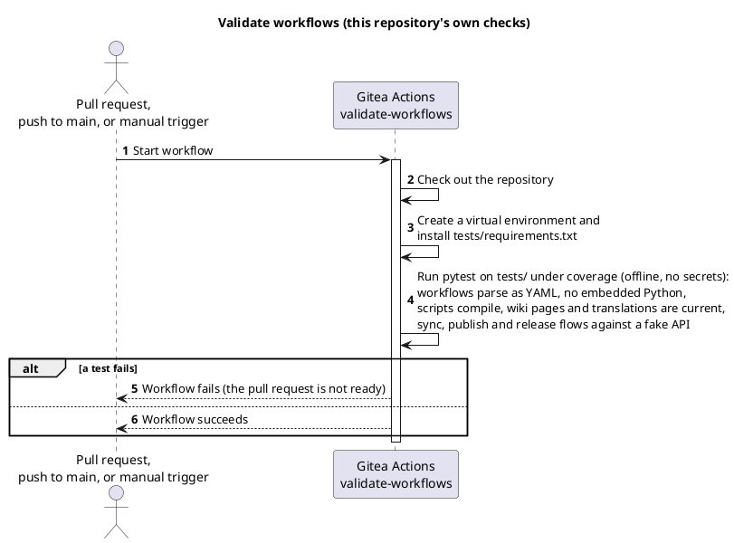

<!-- translation of Home.md, source sha256 e912ad7140a9 -->

> Dette er en oversættelse af [`Home`](Home). Den engelske side er autoritativ, og ændringer her bliver overskrevet, næste gang wikien publiceres.

[English](Home) · **Dansk** · [Bahasa Melayu](Home-ms)

# TirSystem GitHub Actions

En samling af genbrugelige Gitea Actions-workflows til DevOps-professionelle og softwareudviklere, der arbejder på TirSystem-projekter.


## Oversigt

Dette repository er den centrale samling af genbrugelig automatisering til TirSystems repositories. Det primære repository ligger på `git.tirsystem.com` (Gitea) og spejles med push til GitHub.

Det indeholder tolv workflows: synkronisering af metadata til GitHub-spejlet, publicering af wiki (scoped, for hvert repository med en `docs/wiki/`-mappe), fælles kvalitetskontrol for Python og shell, for C og C++ og for C#, kodemålinger og dækningsbadges, en kontrol af, at kommentarer er på engelsk, en statisk sikkerhedsskanning med OpenGrep (scoped), en validering af workflowfilerne og shell-scripts i hvert repository (scoped), et udgivelsesworkflow (scoped, startes manuelt), publicering af accepterede milepæle (scoped, for hvert repository med en `docs/milestones/`-mappe) og repositoryets egen validering. De er listet med formål og diagram under [Workflows](#workflows).


## Workflows

Der er tolv workflows i dette repository. Et **scoped** workflow leveres af instansen til alle repositories i TirSystem-organisationerne og kræver intet i repositoryet; et **genbrugeligt** workflow kaldes fra et repository med `uses:`; de øvrige kører kun her. Diagrammerne er PlantUML-kildekode og er på engelsk.

| Workflow | Fil | Type | Starter ved | Formål |
| --- | --- | --- | --- | --- |
| Sync GitHub mirror metadata | [`sync-github-metadata.yml`](https://git.tirsystem.com/TirSystem/git-workflows/src/branch/main/.gitea/scoped_workflows/sync-github-metadata.yml) | Scoped | push til `main`, manuelt, dagligt kl. 03:17 UTC | Kopierer beskrivelsen og emnerne for et Gitea-repository til dets GitHub push-spejl |
| Publish wiki pages | [`publish-wiki-pages.yml`](https://git.tirsystem.com/TirSystem/git-workflows/src/branch/main/.gitea/scoped_workflows/publish-wiki-pages.yml) | Scoped | push til `main`, der ændrer `docs/wiki/**`, manuelt | Publicerer siderne i `docs/wiki/` til repositoryets wiki; springes over, hvor mappen ikke findes |
| OpenGrep | [`opengrep.yml`](https://git.tirsystem.com/TirSystem/git-workflows/src/branch/main/.gitea/scoped_workflows/opengrep.yml) | Scoped | pull request, push til `main`, manual | Skanner repositoryet med OpenGrep (LGPL-2.1) og et fastlåst sæt af dets fællesskabsregler uden login; et fund af alvorlighed `ERROR` får kørslen til at fejle, de øvrige listes; springes over, hvor ingen sporet fil skannes |
| Validate | [`validate.yml`](https://git.tirsystem.com/TirSystem/git-workflows/src/branch/main/.gitea/scoped_workflows/validate.yml) | Scoped | pull request, push til `main`, manual | Kontrollerer workflowfilerne (de `WF`-kriterier, et script kan afgøre) og kører shellcheck og shfmt på de sporede shell-scripts; en fejl får kørslen til at fejle, `WF-5` er en advarsel; grøn, hvor der intet er at validere |
| Quality checks | [`quality-checks.yml`](https://git.tirsystem.com/TirSystem/git-workflows/src/branch/main/.gitea/workflows/quality-checks.yml) | Genbrugeligt (`workflow_call`) | et kald fra et andet repository | Kører ruff, mypy, shellcheck og shfmt på de sporede filer og ændrer intet |
| Quality checks C++ | [`quality-checks-cpp.yml`](https://git.tirsystem.com/TirSystem/git-workflows/src/branch/main/.gitea/workflows/quality-checks-cpp.yml) | Genbrugeligt (`workflow_call`) | et kald fra et andet repository | Kører clang-format og clang-tidy i præcise versioner på de sporede C- og C++-filer og ændrer intet |
| Quality checks C# | [`quality-checks-csharp.yml`](https://git.tirsystem.com/TirSystem/git-workflows/src/branch/main/.gitea/workflows/quality-checks-csharp.yml) | Genbrugeligt (`workflow_call`) | et kald fra et andet repository | Kører `dotnet format` og `dotnet build` på et præcist .NET SDK 10 eller nyere og ændrer intet |
| Code metrics | [`code-metrics.yml`](https://git.tirsystem.com/TirSystem/git-workflows/src/branch/main/.gitea/workflows/code-metrics.yml) | Genbrugeligt (`workflow_call`) | et kald fra et andet repository | Tæller kodefilerne og kodelinjerne (uden kommentar- og tomme linjer), læser en Cobertura-dækningsrapport og committer tre SVG-badges til en `badges`-gren |
| English comments | [`english-comments.yml`](https://git.tirsystem.com/TirSystem/git-workflows/src/branch/main/.gitea/workflows/english-comments.yml) | Genbrugeligt (`workflow_call`) | et kald fra et andet repository, på en pull request | Bedømmer sproget i de kommentarer og docstrings, en pull request tilføjer, lader kørslen fejle, når én ikke er engelsk, og skriver én kommentar på pull requesten, der nævner forfatteren |
| Release | [`release.yml`](https://git.tirsystem.com/TirSystem/git-workflows/src/branch/main/.gitea/scoped_workflows/release.yml) | Scoped, startes manuelt | manuelt (`version`, `dry_run`) | Opretter versionstagget, udgivelsessiden og, fra 1.0.0, major-tagget i ethvert repository efter kontrollerne; kræver secreten `TOKEN_FOR_GITEA_RELEASE` uden reserve |
| Publicering af accepterede milepæle | [`sync-milestones.yml`](https://git.tirsystem.com/TirSystem/git-workflows/src/branch/main/.gitea/scoped_workflows/sync-milestones.yml) | Scoped | push til hovedgrenen, der ændrer `docs/milestones/**` eller `docs/sqa/reviews/**`, manuelt (tørkørsel som standard) | Opretter eller opdaterer Gitea-milepælen og issues for hver milepæl, der er Accepted med en Go-gennemgang; springes over, hvor `docs/milestones/` ikke findes; kræver secrets'ene `TOKEN_FOR_GITEA_REPO` og `TOKEN_FOR_GITEA_ISSUES` uden fallback |
| Validate workflows | [`validate-workflows.yml`](https://git.tirsystem.com/TirSystem/git-workflows/src/branch/main/.gitea/workflows/validate-workflows.yml) | Kun dette repository | pull request, push til `main`, manuelt | Læser hvert workflow som YAML og kører offline-testene |

### Synkronisering af GitHub-metadata

Synkroniserer Gitea-repositoryets beskrivelse og emner til GitHub push-spejlet.

#### Tidsplan (cron)

Dagligt kl. 03:17 UTC (`17 3 * * *`) samt ved hvert push til `main` og manuel `workflow_dispatch`.

#### Workflow



### Kvalitetskontrol

Et genbrugeligt workflow til Python og shell, kaldt med `uses: TirSystem/git-workflows/.gitea/workflows/quality-checks.yml@v1` (se [vejledningen](QualityChecksPythonShell)).

#### Workflow



### Kvalitetskontrol C++

Et genbrugeligt workflow til C og C++, kaldt med `uses: TirSystem/git-workflows/.gitea/workflows/quality-checks-cpp.yml@v1` (ADR-0008). Repositoryet skal have en `.clang-format`; en `.clang-tidy` og en compile-database er valgfrie.

#### Workflow



### Kvalitetskontrol C#

Et genbrugeligt workflow til C#, kaldt med `uses: TirSystem/git-workflows/.gitea/workflows/quality-checks-csharp.yml@v1` (ADR-0008). Det installerer det præcise .NET SDK, som `dotnet-sdk-version` angiver (10 eller nyere), og skal bruge netværket til pakkegendannelsen.

#### Workflow



### Kodemålinger og dækningsbadges

Et genbrugeligt workflow, der tæller kodefilerne og kodelinjerne (uden kommentar- og tomme linjer) i et repository og udgiver dem sammen med testdækningen som tre SVG-badges på en `badges`-gren, kaldt med `uses: TirSystem/git-workflows/.gitea/workflows/code-metrics.yml@v2` (ADR-0010). Det kræver `contents: write` og kører ingen test: et tidligere job hos kalderen frembringer en dækningsrapport i Cobertura XML-format og uploader den som artefakt ([vejledning](CodeMetrics-da)).

#### Workflow



### Engelske kommentarer

Et genbrugeligt workflow, der kontrollerer, at de kommentarer og docstrings, en pull request tilføjer, er skrevet på engelsk, lader kørslen fejle, når én ikke er det, og skriver én kommentar på pull requesten, der nævner forfatteren. Det ændrer ingen fil og sender ingen kildetekst ud af instansen; at markere kontrollen som påkrævet i grenbeskyttelsen er det, der blokerer sammenfletningen ([vejledning](EnglishComments-da), ADR-0012).

#### Workflow



### OpenGrep

Et scoped workflow, der skanner repositoryet med OpenGrep v1.33.0 (en LGPL-2.1-fork af Semgrep CE) og reglerne fra `opengrep/opengrep-rules` fastlåst til ét commit og hentet med git under kørslen. OpenGrep er én kørbar fil, hentet fra GitHub-udgivelsen og kontrolleret mod en fastlåst sha256, uden `pip` og uden en konto; kun Linux x86_64-runnere understøttes. Et fund af alvorlighed `ERROR` får kørslen til at fejle; `WARNING` og `INFO` listes som annotationer og i jobbets resumé. Det læser kun filer, har ingen hemmelighed og sender ingen kildetekst ud af runneren ([vejledning](OpenGrep-da), ADR-0015).

#### Workflow

```plantuml
@startuml
title OpenGrep scan (scoped workflow)

autonumber

actor "Pull request or push
to main" as Event
participant "Gitea Actions
opengrep" as Workflow
participant "github.com" as Registry

Event -> Workflow: Start in every repository
activate Workflow

Workflow -> Workflow: Check out the repository and the shared script
Workflow -> Registry: Download the pinned OpenGrep and check its sha256
Workflow -> Registry: Fetch the pinned rules with git
Workflow -> Workflow: Scan the files and read the JSON report

alt no file is scanned
  Workflow --> Event: run passed, nothing to scan
else a finding of severity ERROR
  Workflow --> Event: run failed (a required check blocks the merge)
else only WARNING and INFO findings
  Workflow --> Event: run passed, findings listed
end

deactivate Workflow
@enduml
```

### Validate

Et scoped workflow, der kontrollerer workflowfilerne (`*.yml` og `*.yaml` direkte i `.gitea/workflows`, `.gitea/scoped_workflows` og `.github/workflows`) mod de kriterier i `QC-WF-001`, et script kan afgøre (`WF-1`, `WF-2`, `WF-3`, `WF-5`, `WF-7`, `WF-8`, `WF-9`, `WF-10`, `WF-14`, `WF-20`), og kører `shellcheck` 0.10.0.1 og `shfmt` 3.11.0.2 på de sporede `*.sh`-filer. Hvert fund er en fejl undtagen `WF-5`, som er en advarsel. Statussen er `Validate / validate (<event>)`, som udgivelsesworkflowet kræver. Det læser kun filer, har `permissions: contents: read` og ingen hemmelighed ([vejledning](Validate-da), ADR-0016).

#### Workflow

```plantuml
@startuml
title Validate (scoped workflow)

autonumber

actor "Pull request or push
to main" as Event
participant "Gitea Actions
validate" as Workflow
participant "PyPI" as Registry

Event -> Workflow: Start in every repository
activate Workflow

Workflow -> Workflow: Check out the repository and the shared script
Workflow -> Registry: Install the pinned PyYAML, shellcheck and shfmt
Workflow -> Workflow: Check the workflow files and the shell scripts

alt no workflow file and no shell script
  Workflow --> Event: run passed, nothing to validate
else an error or a tool finds problems
  Workflow --> Event: run failed (a required check blocks the merge)
else only WF-5 warnings
  Workflow --> Event: run passed, warnings listed
end

deactivate Workflow
@enduml
```

### Udgivelse

Et scoped workflow, der startes manuelt af en vedligeholder i det repository, der skal udgives, med `version` (`MAJOR.MINOR.PATCH`) og `dry_run`; med `dry_run` `true` (standard) kontrollerer det kun og skriver intet (se [udgivelsesprocessen](https://git.tirsystem.com/TirSystem/git-workflows/src/branch/main/guides/release-process.md), ADR-0017). Det skriver med organisationens secret `TOKEN_FOR_GITEA_RELEASE` (scope `write:repository`, en dedikeret bruger; se [vejledningen om credentials](Credentials-da)), som er påkrævet uden reserve til kørslens token. Standardbranchen læses fra API'et. Begge changelog-formater læses (`## [1.2.0] - 2026-10-21` og `## 0.18.0 (2026-10-28)`), og major-tagget `vN` findes kun fra version 1.0.0. Det erstatter workflowet `.gitea/workflows/release.yml`, som er fjernet. Om tokenet kan skrive i en scoped kørsel mangler stadig at blive verificeret på instansen (MIL-018, opgave 1).

#### Workflow

```plantuml
@startuml
title Release a repository

autonumber

actor "Maintainer
(workflow_dispatch: version, dry_run)" as Trigger
participant "Gitea Actions
release (scoped)" as Workflow
participant "Gitea REST API" as Gitea

Trigger -> Workflow: Start with version and dry_run
activate Workflow

Workflow -> Workflow: Check the secret TOKEN_FOR_GITEA_RELEASE,
the version and read CHANGELOG.md
alt secret missing, version malformed or no changelog entry
  Workflow --> Trigger: Fail with [configuration] or [validation]
end

Workflow -> Gitea: GET repository (default branch), GET branch
and GET status of the commit
Gitea --> Workflow: Tip of the default branch and the validation run
alt commit is not the tip of the default branch,
or Validate / validate (push) is missing or not green
  Workflow --> Trigger: Fail with [validation]
(no tag is created)
end

Workflow -> Gitea: GET tags
Gitea --> Workflow: Existing tags
alt tag vMAJOR.MINOR.PATCH exists
  Workflow --> Trigger: Fail with [validation]
(tags are never moved)
end

alt dry_run is true (default)
  Workflow --> Trigger: Log what would be created and stop
else
  Workflow -> Gitea: POST release (creates the version tag,
body is the changelog entry)
  opt version 1.0.0 or later and the highest version of its major
    Workflow -> Gitea: DELETE and POST the major tag vMAJOR
  end
  Workflow --> Trigger: Released
end
deactivate Workflow
@enduml
```

### Publicering af wiki-sider

Et scoped workflow: instansen kører det i hvert repository i organisationen, så der behøves hverken et kald eller en markørfil. Et repository tilmelder sig ved at have en `docs/wiki`-mappe; hvor der ingen er, slutter kørslen uden at gøre noget. Det publicerer Markdown-siderne i `docs/wiki` til repositoryets wiki og beholder de wiki-sider, der ikke findes i mappen. Det kræver organisationens secret `TOKEN_FOR_GITEA_WIKI`.

#### Workflow



### Publicering af accepterede milepæle

Et scoped workflow: instansen kører det i hvert repository i organisationen, og et repository tilvælger det ved at have en `docs/milestones/`-mappe; hvor der ingen er, slutter kørslen uden at gøre noget. Ved et push til hovedgrenen, der ændrer milepælene eller deres gennemgange, oprettes eller opdateres hver milepæl, hvis seneste række i Version History er Accepted, og hvis seneste gennemgang er en Go, på Gitea med sine opgaver som issues. Intet lukkes eller slettes. En manuel kørsel er en tørkørsel, medmindre `dry_run` slås fra. Frameworkets scripts kommer fra projektets egen `framework/`-submodul eller, hvor der ingen er, fra en framework-udgivelse, der er fastlåst i workflowets script; loggen skriver hvilken. Det kræver organisationens secrets `TOKEN_FOR_GITEA_REPO` (læse repositories) og `TOKEN_FOR_GITEA_ISSUES` (issues og milepæle) uden fallback ([vejledning](SyncMilestones-da), ADR-0018). Secrets'ene og det private framework i en scoped kørsel er endnu ikke verificeret på instansen (MIL-019).

#### Workflow



### Validering af workflows

Repositoryets egen validering: de offline-tests, der er en betingelse for hver pull request.

#### Workflow




## Krav

- En Gitea-instans med Actions aktiveret og en runner med labelen `ubuntu-latest` og `python3`
- Et konfigureret GitHub push-spejl på Gitea-repositoryet (højst ét; repositories uden spejl springes over uden fejl)
- Repository-secrets:
  - `TOKEN_FOR_GITEA_REPO`: Gitea API-token (kun tokenet, ingen JSON)
  - `PAT_FOR_GITHUB`: et GitHub personal access token, der må redigere spejl-repositoryet (kun tokenet, ingen JSON)
  - `TOKEN_FOR_GITEA_WIKI` (kun for repositories, der publicerer en wiki, se [tilslutningsvejledningen](Onboarding-da)): et Gitea-token, der kan skrive til wikien, gemt som en secret i repositoryets organisation; der er ingen reserve til `TOKEN_FOR_GITEA_REPO`


## Opsætning

Der skal ikke installeres afhængigheder; workflowet bruger kun Pythons standardbibliotek.

1. Klon repositoryet:
   ```bash
   git clone ssh://git@git.tirsystem.com:10022/TirSystem/git-workflows.git
   ```
2. Tilføj de secrets, der er nævnt under [Krav](#krav), til repositoryets indstillinger i Gitea.
3. Konfigurer GitHub push-spejlet i repositoryets indstillinger.


## Kørsel

Workflows kører automatisk ved push til `main` og efter den daglige tidsplan. For at køre manuelt skal du starte **Sync GitHub mirror metadata** via `workflow_dispatch` fra fanen Actions i Gitea.


## Tests

Workflow-filerne og scripts i `tools/` valideres af offline-tests, som hverken kræver netværksadgang eller secrets:

```bash
python3 -m venv .venv
source .venv/bin/activate        # Windows PowerShell: .venv\Scripts\Activate.ps1
python -m pip install -r tests/requirements.txt
python -m coverage run -m pytest -q tests
python -m coverage report
```

De samme kontroller kører ved hver pull request og hvert push til `main` gennem [`validate-workflows.yml`](https://git.tirsystem.com/TirSystem/git-workflows/src/branch/main/.gitea/workflows/validate-workflows.yml). De parser alle workflows som YAML, kontrollerer at ingen indlejrer Python, kompilerer scripts i `tools/`, kræver eksplicitte jobtilladelser og tester parsing af credentials, parsing af push-spejlets adresse og synkroniserings- og publiceringsforløbene mod et falsk API. Kørslen fejler, når linje- og forgreningsdækningen af `tools/` er under 95 % (`.coveragerc`).

Efter en ændring af synkroniseringsworkflowet skal du også starte **Sync GitHub mirror metadata** manuelt i Gitea og sammenligne beskrivelsen og emnerne på GitHub-spejlet.
