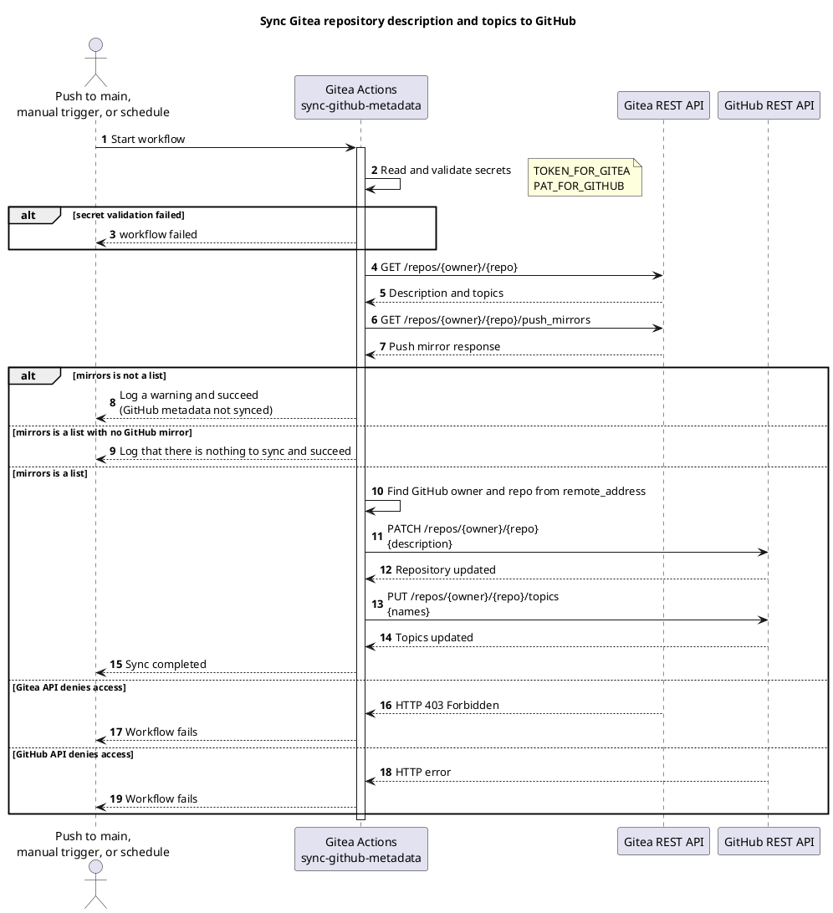
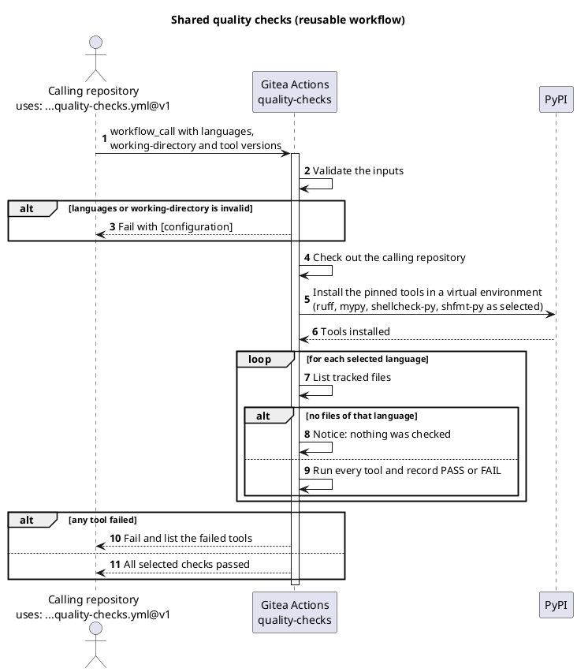
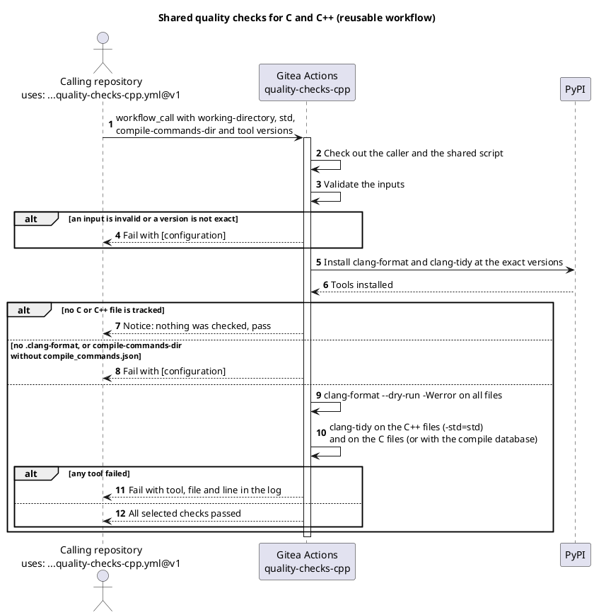
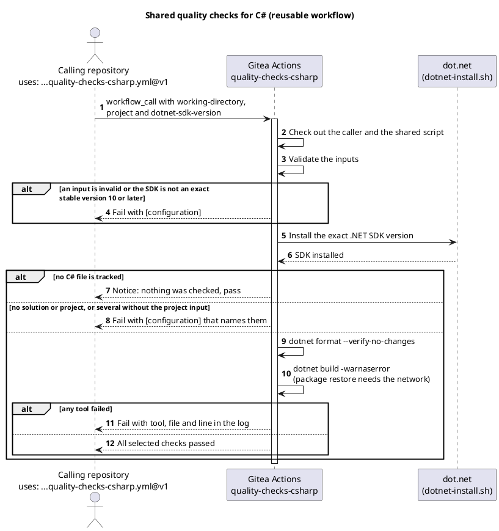
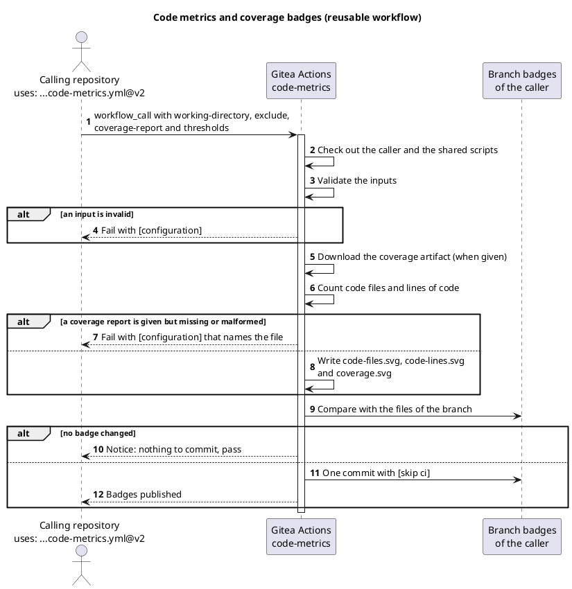
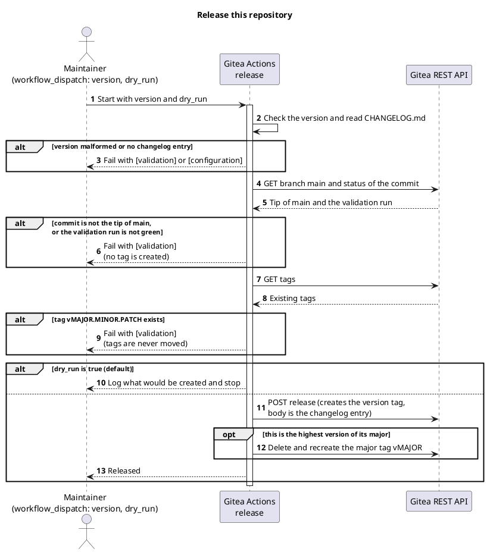
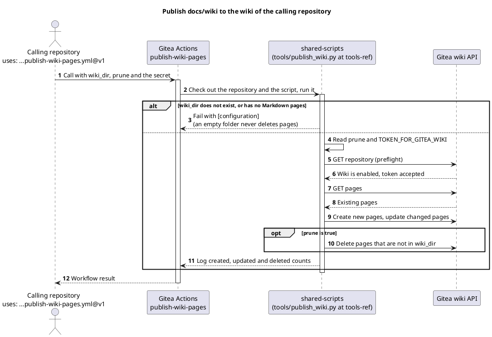
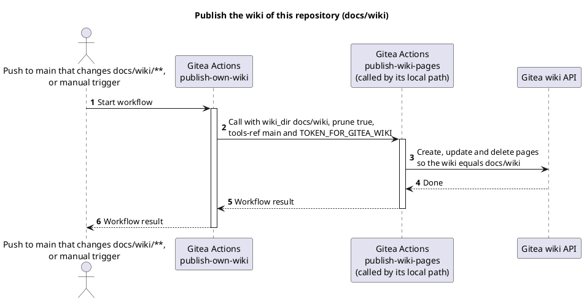
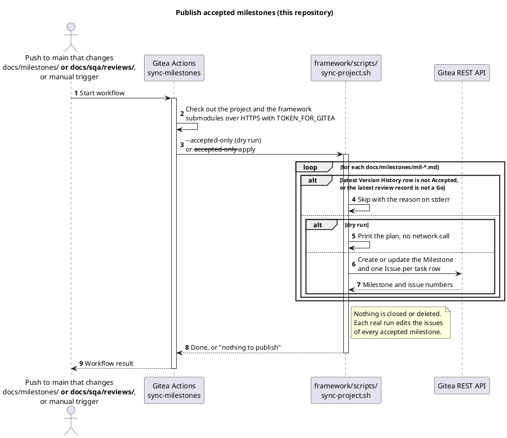
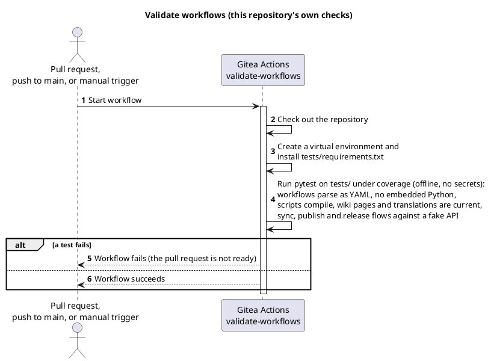

<!-- translation of Home.md, source sha256 f726872da8b9 -->

> Ini ialah terjemahan [`Home`](Home). Halaman bahasa Inggeris ialah teks yang sah, dan perubahan di sini akan ditimpa pada penerbitan wiki yang seterusnya.

[English](Home) | [Dansk](Home.da) | Bahasa Melayu

# TirSystem GitHub Actions

Koleksi aliran kerja (workflow) Gitea Actions yang boleh digunakan semula untuk profesional DevOps dan jurutera perisian yang mengusahakan projek TirSystem.


## Gambaran keseluruhan

Repositori ini ialah koleksi pusat bagi automasi yang boleh digunakan semula untuk repositori TirSystem. Repositori utama berada di `git.tirsystem.com` (Gitea) dan dicerminkan dengan push ke GitHub.

Ia mengandungi sebelas aliran kerja: penyegerakan metadata ke cermin GitHub, penerbitan wiki (dipanggil oleh setiap repositori), semakan kualiti bersama untuk Python dan shell, untuk C dan C++ serta untuk C#, metrik kod dan lencana liputan, semakan bahawa komen ditulis dalam bahasa Inggeris, aliran kerja keluaran, penerbitan pencapaian (milestone) yang diterima dan pengesahan repositori sendiri. Ia disenaraikan dengan tujuan dan rajah di bawah [Aliran kerja](#aliran-kerja).


## Aliran kerja

Terdapat sebelas aliran kerja dalam repositori ini. Aliran kerja **scoped** dihantar oleh instans ke setiap repositori organisasi TirSystem dan tidak memerlukan apa-apa dalam repositori; aliran kerja **boleh guna semula** dipanggil oleh sebuah repositori dengan `uses:`; yang lain hanya berjalan di sini. Rajah ialah kod sumber PlantUML dan dalam bahasa Inggeris.

| Aliran kerja | Fail | Jenis | Bermula apabila | Tujuan |
| --- | --- | --- | --- | --- |
| Sync GitHub mirror metadata | [`sync-github-metadata.yml`](https://git.tirsystem.com/TirSystem/git-workflows/src/branch/main/.gitea/scoped_workflows/sync-github-metadata.yml) | Scoped | push ke `main`, manual, setiap hari 03:17 UTC | Menyalin penerangan dan topik repositori Gitea ke push mirror GitHub-nya |
| Publish wiki pages | [`publish-wiki-pages.yml`](https://git.tirsystem.com/TirSystem/git-workflows/src/branch/main/.gitea/workflows/publish-wiki-pages.yml) | Boleh guna semula (`workflow_call`) | panggilan daripada repositori lain | Menerbitkan halaman dalam `docs/wiki/` (atau folder yang dinamakan oleh `wiki_dir`) ke wiki repositori pemanggil |
| Quality checks | [`quality-checks.yml`](https://git.tirsystem.com/TirSystem/git-workflows/src/branch/main/.gitea/workflows/quality-checks.yml) | Boleh guna semula (`workflow_call`) | panggilan daripada repositori lain | Menjalankan ruff, mypy, shellcheck dan shfmt pada fail yang dijejaki dan tidak mengubah apa-apa |
| Quality checks C++ | [`quality-checks-cpp.yml`](https://git.tirsystem.com/TirSystem/git-workflows/src/branch/main/.gitea/workflows/quality-checks-cpp.yml) | Boleh guna semula (`workflow_call`) | panggilan daripada repositori lain | Menjalankan clang-format dan clang-tidy pada versi tepat pada fail C dan C++ yang dijejaki dan tidak mengubah apa-apa |
| Quality checks C# | [`quality-checks-csharp.yml`](https://git.tirsystem.com/TirSystem/git-workflows/src/branch/main/.gitea/workflows/quality-checks-csharp.yml) | Boleh guna semula (`workflow_call`) | panggilan daripada repositori lain | Menjalankan `dotnet format` dan `dotnet build` pada .NET SDK 10 atau lebih baharu yang tepat dan tidak mengubah apa-apa |
| Code metrics | [`code-metrics.yml`](https://git.tirsystem.com/TirSystem/git-workflows/src/branch/main/.gitea/workflows/code-metrics.yml) | Boleh guna semula (`workflow_call`) | panggilan daripada repositori lain | Mengira fail kod dan baris kod (tanpa baris komen dan baris kosong), membaca laporan liputan Cobertura dan melakukan commit tiga lencana SVG ke cabang `badges` |
| English comments | [`english-comments.yml`](https://git.tirsystem.com/TirSystem/git-workflows/src/branch/main/.gitea/workflows/english-comments.yml) | Boleh guna semula (`workflow_call`) | panggilan daripada repositori lain, pada pull request | Menilai bahasa komen dan docstring yang ditambah oleh pull request, menggagalkan larian apabila ada yang bukan bahasa Inggeris dan menulis satu komen pada pull request yang menyebut penulisnya |
| Publish own wiki | [`publish-own-wiki.yml`](https://git.tirsystem.com/TirSystem/git-workflows/src/branch/main/.gitea/workflows/publish-own-wiki.yml) | Repositori ini sahaja | push ke `main` yang mengubah `docs/wiki/**`, manual | Memanggil aliran kerja boleh guna semula Publish wiki pages untuk wiki repositori ini |
| Release | [`release.yml`](https://git.tirsystem.com/TirSystem/git-workflows/src/branch/main/.gitea/workflows/release.yml) | Repositori ini sahaja | manual | Mencipta tag versi, halaman keluaran dan tag major selepas semakan |
| Menerbitkan milestone yang diterima | [`sync-milestones.yml`](https://git.tirsystem.com/TirSystem/git-workflows/src/branch/main/.gitea/workflows/sync-milestones.yml) | Repositori ini sahaja | push ke `main` yang mengubah `docs/milestones/**` atau `docs/sqa/reviews/**`, manual (larian percubaan secara lalai) | Mencipta atau mengemas kini milestone Gitea dan isu bagi setiap milestone yang Accepted dengan semakan Go |
| Validate workflows | [`validate-workflows.yml`](https://git.tirsystem.com/TirSystem/git-workflows/src/branch/main/.gitea/workflows/validate-workflows.yml) | Repositori ini sahaja | pull request, push ke `main`, manual | Menghurai setiap aliran kerja sebagai YAML dan menjalankan ujian luar talian |

### Menyegerakkan metadata GitHub

Menyegerakkan penerangan dan topik repositori Gitea ke push mirror GitHub.

#### Jadual (cron)

Setiap hari pada 03:17 UTC (`17 3 * * *`), serta pada setiap push ke `main` dan `workflow_dispatch` manual.

#### Aliran kerja



### Semakan kualiti

Aliran kerja boleh guna semula untuk Python dan shell, dipanggil dengan `uses: TirSystem/git-workflows/.gitea/workflows/quality-checks.yml@v1` (lihat [panduan](QualityChecksPythonShell)).

#### Aliran kerja



### Semakan kualiti C++

Aliran kerja boleh guna semula untuk C dan C++, dipanggil dengan `uses: TirSystem/git-workflows/.gitea/workflows/quality-checks-cpp.yml@v1` (ADR-0008). Repositori mesti mempunyai `.clang-format`; `.clang-tidy` dan pangkalan data kompilasi adalah pilihan.

#### Aliran kerja



### Semakan kualiti C#

Aliran kerja boleh guna semula untuk C#, dipanggil dengan `uses: TirSystem/git-workflows/.gitea/workflows/quality-checks-csharp.yml@v1` (ADR-0008). Ia memasang .NET SDK tepat yang diberikan oleh `dotnet-sdk-version` (10 atau lebih baharu) dan memerlukan rangkaian untuk pemulihan pakej.

#### Aliran kerja



### Metrik kod dan lencana liputan

Aliran kerja boleh guna semula yang mengira fail kod dan baris kod (tanpa baris komen dan baris kosong) sesebuah repositori dan menerbitkannya, bersama liputan ujian, sebagai tiga lencana SVG pada cabang `badges`, dipanggil dengan `uses: TirSystem/git-workflows/.gitea/workflows/code-metrics.yml@v2` (ADR-0010). Ia memerlukan `contents: write` dan tidak menjalankan sebarang ujian: kerja yang lebih awal oleh pemanggil menghasilkan laporan liputan format Cobertura XML dan memuat naiknya sebagai artifak ([panduan](CodeMetrics.ms)).

#### Aliran kerja



### Komen dalam bahasa Inggeris

Aliran kerja boleh guna semula yang menyemak bahawa komen dan docstring yang ditambah oleh pull request ditulis dalam bahasa Inggeris, menggagalkan larian apabila ada yang tidak, dan menulis satu komen pada pull request yang menyebut penulisnya. Ia tidak mengubah sebarang fail dan tidak menghantar teks sumber keluar daripada instans; menandakan semakan sebagai wajib dalam perlindungan cabang ialah yang menyekat penggabungan ([panduan](EnglishComments.ms), ADR-0012).

#### Aliran kerja

```plantuml
@startuml
title English comments check (reusable workflow)

autonumber

actor "Pull request
uses: ...english-comments.yml@v2" as Caller
participant "Gitea Actions
english-comments" as Workflow
participant "Gitea REST API" as Gitea

Caller -> Workflow: workflow_call with scope, exclude,
allowed-words-file, threshold and min-words
activate Workflow

Workflow -> Workflow: Check out the full history and the shared scripts
Workflow -> Workflow: Install the pinned language detector
Workflow -> Workflow: Read the comments on the added lines
Workflow -> Workflow: Remove paths, options, identifiers and allowed words
Workflow -> Workflow: Judge the language of each comment block

alt a block is not English
  Workflow -> Gitea: Create or update one comment that mentions the author
  Workflow --> Caller: run failed (the required check blocks the merge)
else all blocks are English
  Workflow -> Gitea: Mark an earlier comment resolved
  Workflow --> Caller: run passed
end

deactivate Workflow
@enduml
```

### Keluaran

Dimulakan secara manual oleh penyelenggara; dengan `dry_run` `true` (lalai) ia hanya menyemak (lihat [proses keluaran](https://git.tirsystem.com/TirSystem/git-workflows/src/branch/main/guides/release-process.md)).

#### Aliran kerja



### Menerbitkan halaman wiki

Aliran kerja boleh guna semula (ADR-0009). Sesebuah repositori memanggilnya daripada aliran kerjanya sendiri, jadi panggilan itu ialah pilihan menyertai dan tiada fail penanda diperlukan. Ia menerbitkan halaman Markdown dalam `wiki_dir` (lalai `docs/wiki`) ke wiki repositori pemanggil, dan memadam halaman yang tiada dalam folder hanya apabila `prune` ialah `true`.

```yaml
on:
  push:
    branches: [ main ]
    paths: [ "docs/wiki/**" ]
jobs:
  wiki:
    uses: TirSystem/git-workflows/.gitea/workflows/publish-wiki-pages.yml@v1
    secrets:
      TOKEN_FOR_GITEA_WIKI: ${{ secrets.TOKEN_FOR_GITEA_WIKI }}
```

#### Aliran kerja



### Menerbitkan wiki sendiri

Wiki repositori ini ialah `docs/wiki/`. Aliran kerja ini memanggil aliran kerja boleh guna semula di atas melalui laluan tempatannya, dengan `prune` ditetapkan kepada `true` supaya wiki sentiasa sama dengan folder dan `tools-ref` ditetapkan kepada `main` supaya skrip daripada commit yang sama dijalankan. Ia ialah pemanggil yang disalin oleh projek daripada `templates/ci/publish-wiki.yml` framework.

#### Aliran kerja



### Menerbitkan milestone yang diterima

Kebenaran tetap untuk menerbitkan: pada push ke `main` yang mengubah milestone atau semakannya, setiap milestone yang baris terkini Version History-nya Accepted dan semakan terkininya Go dicipta atau dikemas kini di Gitea dengan tugasnya sebagai isu. Tiada apa-apa ditutup atau dipadam. Larian manual ialah larian percubaan kecuali `dry_run` dimatikan. Ia menggunakan secret `TOKEN_FOR_GITEA` dan peraturan `--accepted-only` framework yang dipasang (v0.5.0 atau lebih baharu).

#### Aliran kerja



### Mengesahkan aliran kerja

Pengesahan repositori sendiri: ujian luar talian yang menjadi syarat bagi setiap pull request.

#### Aliran kerja




## Keperluan

- Satu instans Gitea dengan Actions diaktifkan dan satu runner yang menyediakan `ubuntu-latest` dengan `python3`
- Satu push mirror GitHub yang dikonfigurasi pada repositori Gitea (paling banyak satu; repositori tanpa cermin dilangkau dengan jayanya)
- Rahsia (secret) repositori:
  - `TOKEN_FOR_GITEA`: token API Gitea (token sahaja, tanpa JSON)
  - `PAT_FOR_GITHUB`: personal access token GitHub yang dibenarkan mengubah suai repositori cermin (token sahaja, tanpa JSON)
  - `TOKEN_FOR_GITEA_WIKI` (hanya untuk repositori yang menerbitkan wiki, lihat [panduan menyertakan repositori](Onboarding.ms)): token Gitea yang boleh menulis ke wiki, disimpan sebagai secret organisasi repositori; tiada sandaran kepada `TOKEN_FOR_GITEA`


## Persediaan

Tiada kebergantungan perlu dipasang; aliran kerja hanya menggunakan pustaka standard Python.

1. Klon repositori:
   ```bash
   git clone ssh://git@git.tirsystem.com:10022/TirSystem/git-workflows.git
   ```
2. Tambah rahsia yang disenaraikan di bawah [Keperluan](#keperluan) ke tetapan repositori dalam Gitea.
3. Konfigurasikan push mirror GitHub dalam tetapan repositori.


## Jalankan

Aliran kerja berjalan secara automatik pada push ke `main` dan mengikut jadual harian. Untuk menjalankannya secara manual, cetuskan **Sync GitHub mirror metadata** melalui `workflow_dispatch` dari tab Actions dalam Gitea.


## Ujian

Fail aliran kerja dan skrip dalam `tools/` disahkan oleh ujian luar talian yang tidak memerlukan akses rangkaian dan tidak memerlukan rahsia:

```bash
python3 -m venv .venv
source .venv/bin/activate        # Windows PowerShell: .venv\Scripts\Activate.ps1
python -m pip install -r tests/requirements.txt
python -m coverage run -m pytest -q tests
python -m coverage report
```

Semakan yang sama dijalankan pada setiap pull request dan setiap push ke `main` melalui [`validate-workflows.yml`](https://git.tirsystem.com/TirSystem/git-workflows/src/branch/main/.gitea/workflows/validate-workflows.yml). Semakan itu menghurai setiap aliran kerja sebagai YAML, memastikan tiada yang menanam Python, mengkompil skrip dalam `tools/`, memerlukan kebenaran kerja yang jelas, dan menguji penghuraian kelayakan (credentials), penghuraian alamat push mirror serta aliran penyegerakan dan penerbitan terhadap API palsu. Larian gagal apabila liputan baris dan cabang `tools/` di bawah 95% (`.coveragerc`).

Selepas perubahan pada aliran kerja penyegerakan, cetuskan juga **Sync GitHub mirror metadata** secara manual dalam Gitea dan bandingkan penerangan dan topik pada cermin GitHub.
