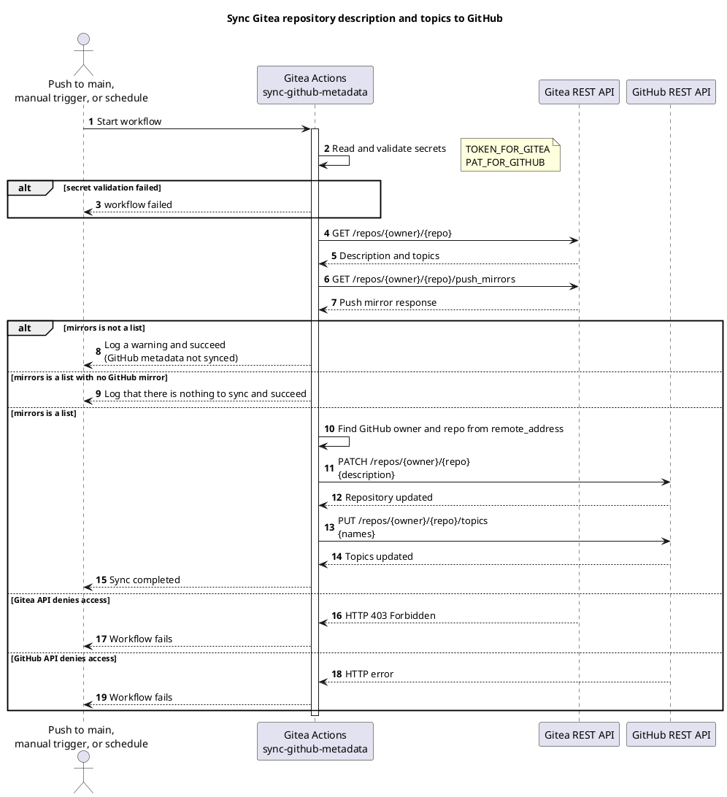

<!-- translation of Capabilities.md, source sha256 c55376110b0c -->

> Dette er en oversættelse af [`Capabilities`](Capabilities). Den engelske side er autoritativ, og ændringer her bliver overskrevet, næste gang wikien publiceres.

[English](Capabilities) | Dansk | [Bahasa Melayu](Capabilities.ms)

## Funktionalitet

Rækker, der siger Implementeret eller Vejledninger er skrevet, findes i dag. Resten er planlagt og følges i [projektplanen](https://git.tirsystem.com/TirSystem/github-action/src/branch/main/docs/project-plan.md), som også beskriver hver enkelt use case.

| Funktionalitet | Status |
| --- | --- |
| Synkronisering af repositorymetadata (Gitea til GitHub-spejl) | Implementeret i `.gitea/scoped_workflows/`, med offline-tests og et valideringsworkflow |
| Konfiguration og validering af workflow-credentials | Implementeret for synkroniseringsworkflowet: en forhåndskontrol tjekker begge tokens før enhver ændring ([vejledning](Credentials.da)) |
| Tilslutning af et repository, administration af runners, fejlfinding | Vejledninger er skrevet ([tilslutning](Onboarding.da), [fejlfinding](Troubleshooting.da)); scoped levering til andre repositories er ikke verificeret endnu; korte use cases er åbne (MIL-002) |
| Publicering af et repositorys wiki fra `wiki/` (tilmelding, leveres til alle organisationer) | Implementeret i `.gitea/scoped_workflows/publish-wiki.yml`, med offline-tests; pilotforsøget i et andet repository afventer (MIL-006) |
| Fælles kvalitetskontrol (Python og shell) | Implementeret som det genbrugelige workflow `.gitea/workflows/quality-checks.yml`, med offline-tests og et forsøg i en anden organisation; tilslutningen i RepoFoundry er til gennemgang ([vejledning](QualityChecks.da)) |
| Versioneret udgivelse og publicering | Planlagt (MIL-004) |

### Synkronisering af GitHub-metadata

Synkroniserer Gitea-repositoryets beskrivelse og emner til GitHub push-spejlet.

#### Tidsplan (cron)

Dagligt kl. 03:17 UTC (`17 3 * * *`) samt ved hvert push til `main` og manuel `workflow_dispatch`.

#### Workflow

