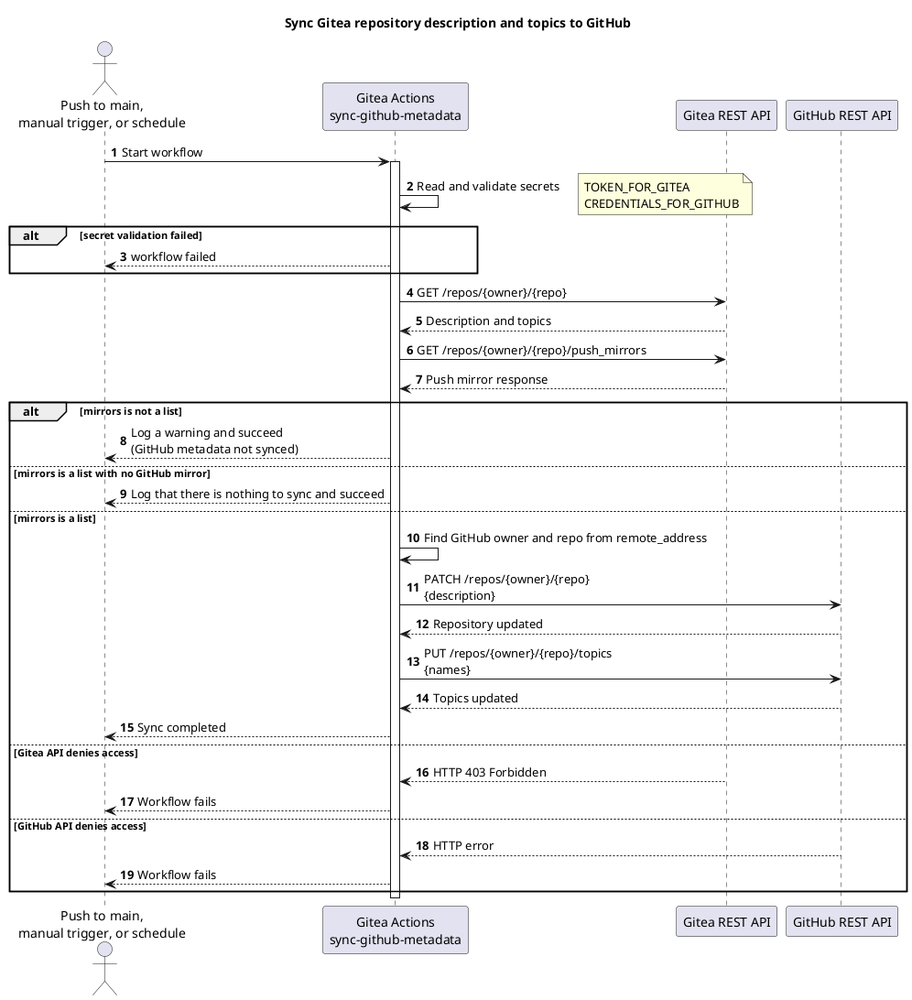

<!-- Generated from README.md by tools/build_wiki.py. Edit the source, not this page. -->

> This page is generated from [`README.md`](https://git.tirsystem.com/TirSystem/github-action/src/branch/main/README.md). Changes made here are overwritten the next time the wiki is published.

English | [Dansk](Capabilities.da) | [Bahasa Melayu](Capabilities.ms)

## Capabilities

Only the first row is implemented. The rest is planned and tracked in the [Project Plan](https://git.tirsystem.com/TirSystem/github-action/src/branch/main/docs/project-plan.md), which also describes each use case.

| Capability | Status |
| --- | --- |
| Synchronize repository metadata (Gitea to GitHub mirror) | Implemented in `.gitea/scoped_workflows/`, with offline tests and a validation workflow |
| Configure and validate workflow credentials | Implemented for the sync workflow: preflight checks both tokens before any change ([guide](Credentials)) |
| Onboard a repository, manage runners, diagnose failures | Guides written ([onboarding](Onboarding), [troubleshooting](Troubleshooting)); scoped delivery to other repositories not yet verified; brief use cases open (MIL-002) |
| Shared quality checks | Planned (MIL-003) |
| Versioned release and publishing | Planned (MIL-004) |

### Sync GitHub metadata

Syncs the Gitea repository description and topics to the GitHub push mirror.

#### Cron

Daily at 03:17 UTC (`17 3 * * *`), plus every push to `main` and manual `workflow_dispatch`.

#### Workflow

