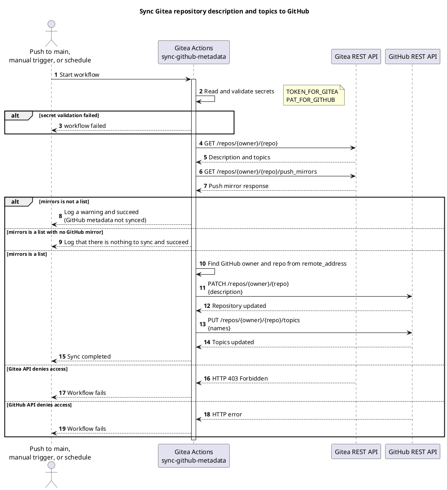

<!-- translation of Capabilities.md, source sha256 5856fdc70a30 -->

> Ini ialah terjemahan [`Capabilities`](Capabilities). Halaman bahasa Inggeris ialah teks yang sah, dan perubahan di sini akan ditimpa pada penerbitan wiki yang seterusnya.

[English](Capabilities) | [Dansk](Capabilities.da) | Bahasa Melayu

## Keupayaan

Hanya baris pertama yang dilaksanakan. Selebihnya dirancang dan dijejaki dalam [Pelan Projek](https://git.tirsystem.com/TirSystem/github-action/src/branch/main/docs/project-plan.md), yang juga menerangkan setiap kes guna (use case).

| Keupayaan | Status |
| --- | --- |
| Menyegerakkan metadata repositori (Gitea ke cermin GitHub) | Dilaksanakan dalam `.gitea/scoped_workflows/`, dengan ujian luar talian dan aliran kerja pengesahan |
| Mengkonfigur dan mengesahkan kelayakan (credentials) aliran kerja | Dilaksanakan untuk aliran kerja penyegerakan: semakan awal (preflight) memeriksa kedua-dua token sebelum sebarang perubahan ([panduan](Credentials.ms)) |
| Menyertakan repositori, mengurus runner, mendiagnosis kegagalan | Panduan telah ditulis ([menyertakan repositori](Onboarding.ms), [diagnosis](Troubleshooting.ms)); penghantaran scoped ke repositori lain belum disahkan; use case ringkas masih terbuka (MIL-002) |
| Semakan kualiti bersama | Dirancang (MIL-003) |
| Keluaran dan penerbitan berversi | Dirancang (MIL-004) |

### Menyegerakkan metadata GitHub

Menyegerakkan penerangan dan topik repositori Gitea ke push mirror GitHub.

#### Jadual (cron)

Setiap hari pada 03:17 UTC (`17 3 * * *`), serta pada setiap push ke `main` dan `workflow_dispatch` manual.

#### Aliran kerja

