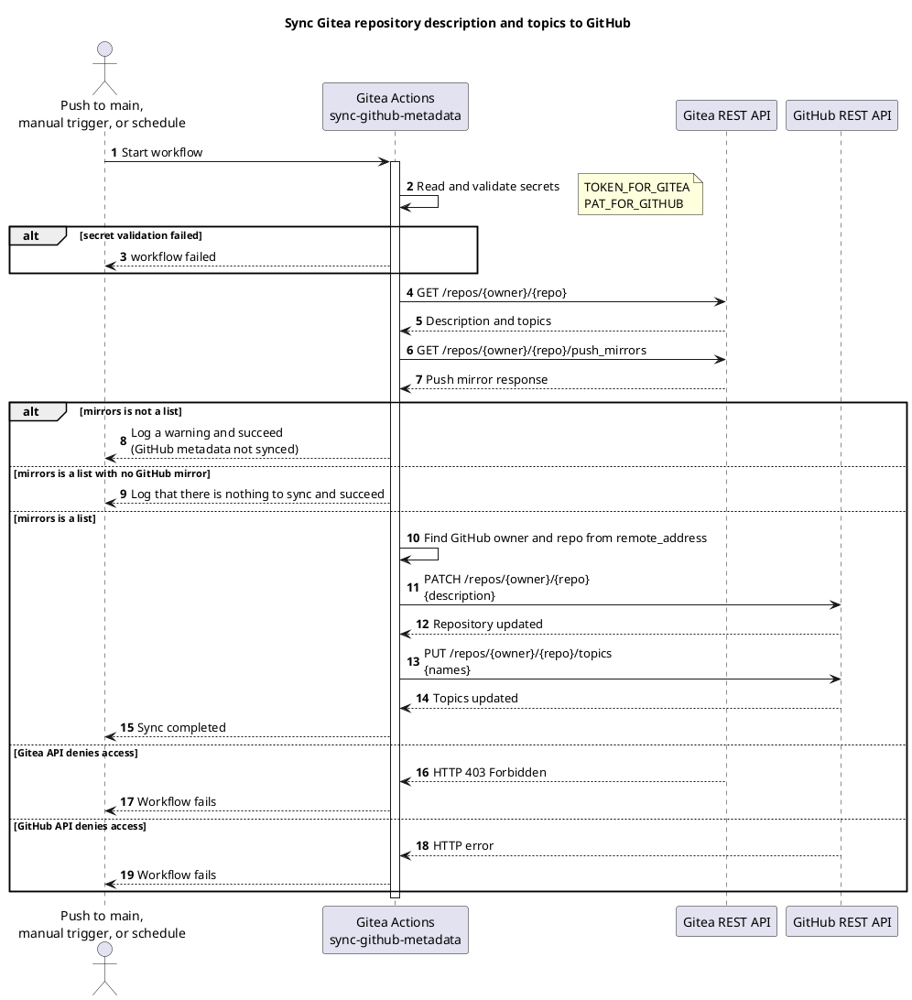
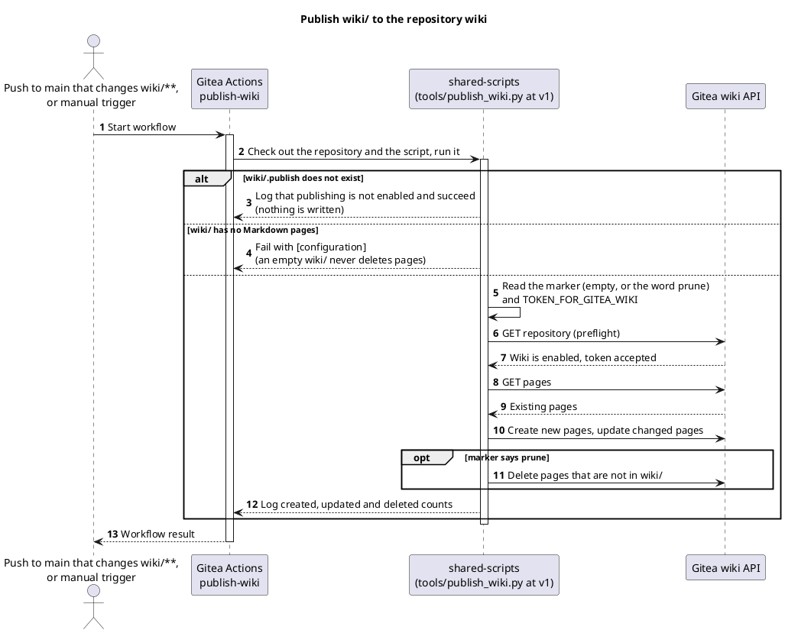
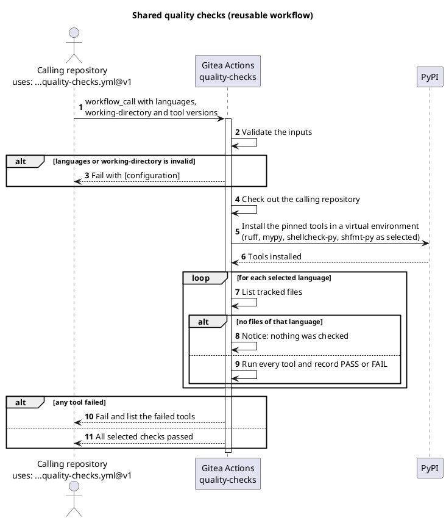
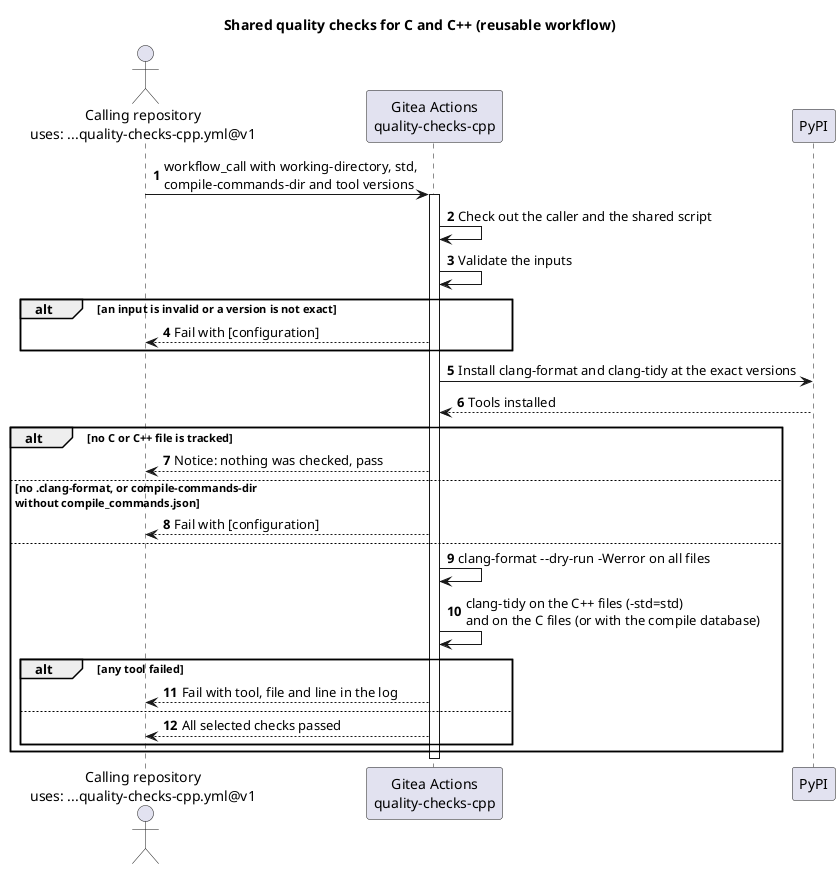
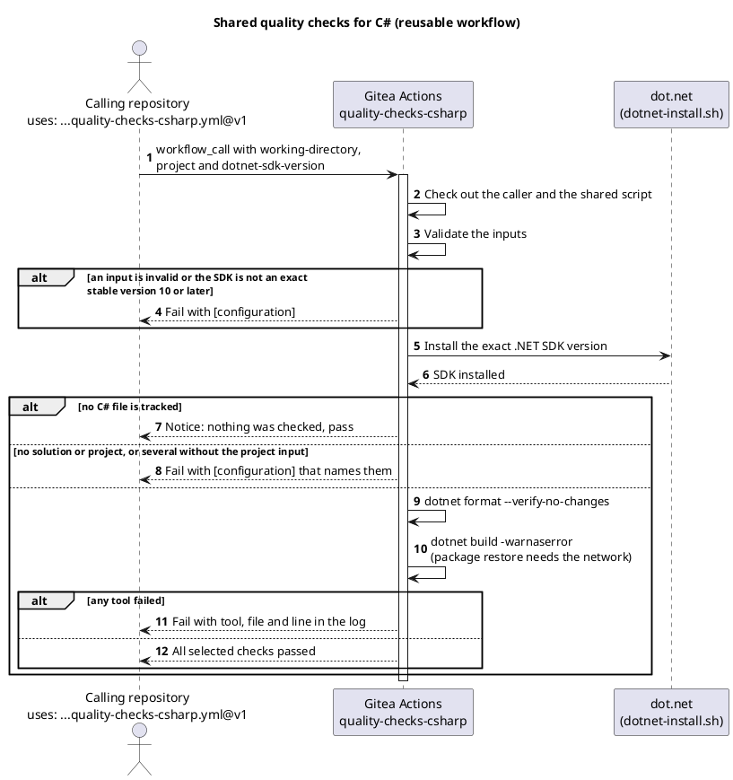
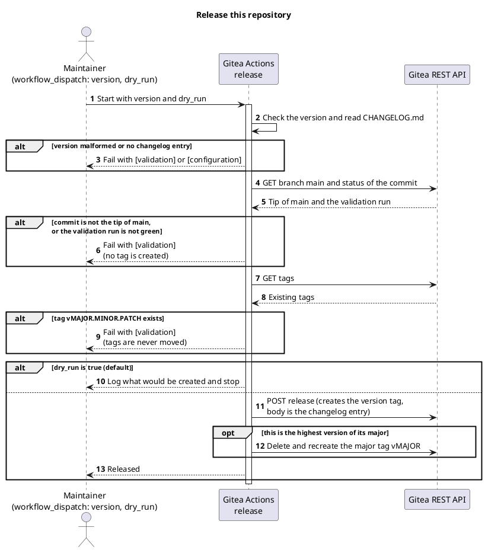
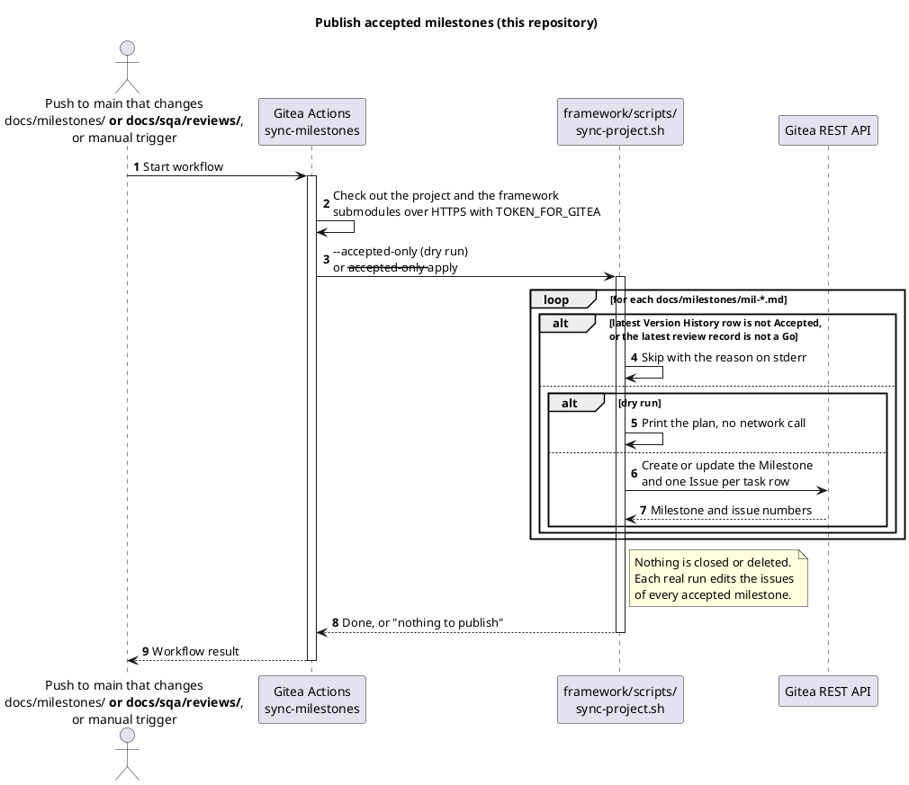
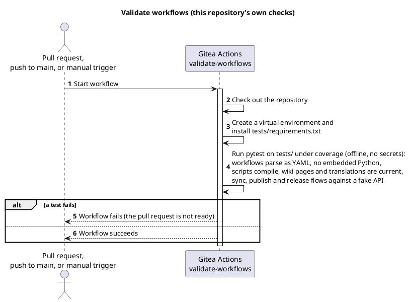

<!-- translation of Home.md, source sha256 5751829e99af -->

> Dette er en oversættelse af [`Home`](Home). Den engelske side er autoritativ, og ændringer her bliver overskrevet, næste gang wikien publiceres.

[English](Home) | Dansk | [Bahasa Melayu](Home.ms)

# TirSystem GitHub Actions

En samling af genbrugelige Gitea Actions-workflows til DevOps-professionelle og softwareudviklere, der arbejder på TirSystem-projekter.


## Oversigt

Dette repository er den centrale samling af genbrugelig automatisering til TirSystems repositories. Det primære repository ligger på `git.tirsystem.com` (Gitea) og spejles med push til GitHub.

Det indeholder otte workflows: synkronisering af metadata til GitHub-spejlet, publicering af wiki, fælles kvalitetskontrol for Python og shell, for C og C++ og for C#, et udgivelsesworkflow, publicering af accepterede milepæle og repositoryets egen validering. De er listet med formål og diagram under [Workflows](#workflows).


## Workflows

Der er otte workflows i dette repository. Et **scoped** workflow leveres af instansen til alle repositories i TirSystem-organisationerne og kræver intet i repositoryet; et **genbrugeligt** workflow kaldes fra et repository med `uses:`; de øvrige kører kun her. Diagrammerne er PlantUML-kildekode og er på engelsk.

| Workflow | Fil | Type | Starter ved | Formål |
| --- | --- | --- | --- | --- |
| Sync GitHub mirror metadata | [`sync-github-metadata.yml`](https://git.tirsystem.com/TirSystem/github-action/src/branch/main/.gitea/scoped_workflows/sync-github-metadata.yml) | Scoped | push til `main`, manuelt, dagligt kl. 03:17 UTC | Kopierer beskrivelsen og emnerne for et Gitea-repository til dets GitHub push-spejl |
| Publish wiki | [`publish-wiki.yml`](https://git.tirsystem.com/TirSystem/github-action/src/branch/main/.gitea/scoped_workflows/publish-wiki.yml) | Scoped, tilmelding med `wiki/.publish` | push til `main`, der ændrer `wiki/**`, manuelt | Publicerer siderne i `wiki/` til repositoryets wiki |
| Quality checks | [`quality-checks.yml`](https://git.tirsystem.com/TirSystem/github-action/src/branch/main/.gitea/workflows/quality-checks.yml) | Genbrugeligt (`workflow_call`) | et kald fra et andet repository | Kører ruff, mypy, shellcheck og shfmt på de sporede filer og ændrer intet |
| Quality checks C++ | [`quality-checks-cpp.yml`](https://git.tirsystem.com/TirSystem/github-action/src/branch/main/.gitea/workflows/quality-checks-cpp.yml) | Genbrugeligt (`workflow_call`) | et kald fra et andet repository | Kører clang-format og clang-tidy i præcise versioner på de sporede C- og C++-filer og ændrer intet |
| Quality checks C# | [`quality-checks-csharp.yml`](https://git.tirsystem.com/TirSystem/github-action/src/branch/main/.gitea/workflows/quality-checks-csharp.yml) | Genbrugeligt (`workflow_call`) | et kald fra et andet repository | Kører `dotnet format` og `dotnet build` på et præcist .NET SDK 10 eller nyere og ændrer intet |
| Release | [`release.yml`](https://git.tirsystem.com/TirSystem/github-action/src/branch/main/.gitea/workflows/release.yml) | Kun dette repository | manuelt | Opretter versionstagget, udgivelsessiden og major-tagget efter kontrollerne |
| Publicering af accepterede milepæle | [`sync-milestones.yml`](https://git.tirsystem.com/TirSystem/github-action/src/branch/main/.gitea/workflows/sync-milestones.yml) | Kun dette repository | push til `main`, der ændrer `docs/milestones/**` eller `docs/sqa/reviews/**`, manuelt (tørkørsel som standard) | Opretter eller opdaterer Gitea-milepælen og issues for hver milepæl, der er Accepted med en Go-gennemgang |
| Validate workflows | [`validate-workflows.yml`](https://git.tirsystem.com/TirSystem/github-action/src/branch/main/.gitea/workflows/validate-workflows.yml) | Kun dette repository | pull request, push til `main`, manuelt | Læser hvert workflow som YAML og kører offline-testene |

### Synkronisering af GitHub-metadata

Synkroniserer Gitea-repositoryets beskrivelse og emner til GitHub push-spejlet.

#### Tidsplan (cron)

Dagligt kl. 03:17 UTC (`17 3 * * *`) samt ved hvert push til `main` og manuel `workflow_dispatch`.

#### Workflow



### Publicering af wiki

Publicerer `wiki/` til repositoryets wiki, kun i et repository, der har tilmeldt sig med `wiki/.publish`. Ordet `prune` i den fil sletter også sider, som ikke findes i `wiki/`.

#### Workflow



### Kvalitetskontrol

Et genbrugeligt workflow til Python og shell, kaldt med `uses: TirSystem/github-action/.gitea/workflows/quality-checks.yml@v1` (se [vejledningen](QualityChecksPythonShell)).

#### Workflow



### Kvalitetskontrol C++

Et genbrugeligt workflow til C og C++, kaldt med `uses: TirSystem/github-action/.gitea/workflows/quality-checks-cpp.yml@v1` (ADR-0008). Repositoryet skal have en `.clang-format`; en `.clang-tidy` og en compile-database er valgfrie.

#### Workflow



### Kvalitetskontrol C#

Et genbrugeligt workflow til C#, kaldt med `uses: TirSystem/github-action/.gitea/workflows/quality-checks-csharp.yml@v1` (ADR-0008). Det installerer det præcise .NET SDK, som `dotnet-sdk-version` angiver (10 eller nyere), og skal bruge netværket til pakkegendannelsen.

#### Workflow



### Udgivelse

Startes manuelt af en vedligeholder; med `dry_run` `true` (standard) kontrollerer det kun (se [udgivelsesprocessen](https://git.tirsystem.com/TirSystem/github-action/src/branch/main/guides/release-process.md)).

#### Workflow



### Publicering af accepterede milepæle

Permanent tilladelse til at publicere: ved et push til `main`, der ændrer milepælene eller deres gennemgange, oprettes eller opdateres hver milepæl, hvis seneste række i Version History er Accepted, og hvis seneste gennemgang er en Go, på Gitea med sine opgaver som issues. Intet lukkes eller slettes. En manuel kørsel er en tørkørsel, medmindre `dry_run` slås fra. Det bruger secret'en `TOKEN_FOR_GITEA` og `--accepted-only`-reglen i det monterede framework (v0.5.0 eller nyere).

#### Workflow



### Validering af workflows

Repositoryets egen validering: de offline-tests, der er en betingelse for hver pull request.

#### Workflow




## Krav

- En Gitea-instans med Actions aktiveret og en runner med labelen `ubuntu-latest` og `python3`
- Et konfigureret GitHub push-spejl på Gitea-repositoryet (højst ét; repositories uden spejl springes over uden fejl)
- Repository-secrets:
  - `TOKEN_FOR_GITEA`: Gitea API-token (kun tokenet, ingen JSON)
  - `PAT_FOR_GITHUB`: et GitHub personal access token, der må redigere spejl-repositoryet (kun tokenet, ingen JSON)
  - `TOKEN_FOR_GITEA_WIKI` (kun for repositories, der publicerer en wiki, se [tilslutningsvejledningen](Onboarding.da)): et Gitea-token, der kan skrive til wikien, gemt som en secret i repositoryets organisation; der er ingen reserve til `TOKEN_FOR_GITEA`


## Opsætning

Der skal ikke installeres afhængigheder; workflowet bruger kun Pythons standardbibliotek.

1. Klon repositoryet:
   ```bash
   git clone ssh://git@git.tirsystem.com:10022/TirSystem/github-action.git
   ```
2. Tilføj de secrets, der er nævnt under [Krav](#krav), til repositoryets indstillinger i Gitea.
3. Konfigurer GitHub push-spejlet i repositoryets indstillinger.


## Kørsel

Workflows kører automatisk ved push til `main` og efter den daglige tidsplan. For at køre manuelt skal du starte **Sync GitHub mirror metadata** via `workflow_dispatch` fra fanen Actions i Gitea.


## Tests

Workflow-filerne og scripts i `tools/` valideres af offline-tests, som hverken kræver netværksadgang eller secrets:

```bash
python3 -m venv .venv
source .venv/bin/activate        # Windows PowerShell: .venv\Scripts\Activate.ps1
python -m pip install -r tests/requirements.txt
python -m coverage run -m pytest -q tests
python -m coverage report
```

De samme kontroller kører ved hver pull request og hvert push til `main` gennem [`validate-workflows.yml`](https://git.tirsystem.com/TirSystem/github-action/src/branch/main/.gitea/workflows/validate-workflows.yml). De parser alle workflows som YAML, kontrollerer at ingen indlejrer Python, kompilerer scripts i `tools/`, kræver eksplicitte jobtilladelser og tester parsing af credentials, parsing af push-spejlets adresse og synkroniserings- og publiceringsforløbene mod et falsk API. Kørslen fejler, når linje- og forgreningsdækningen af `tools/` er under 95 % (`.coveragerc`).

Efter en ændring af synkroniseringsworkflowet skal du også starte **Sync GitHub mirror metadata** manuelt i Gitea og sammenligne beskrivelsen og emnerne på GitHub-spejlet.
