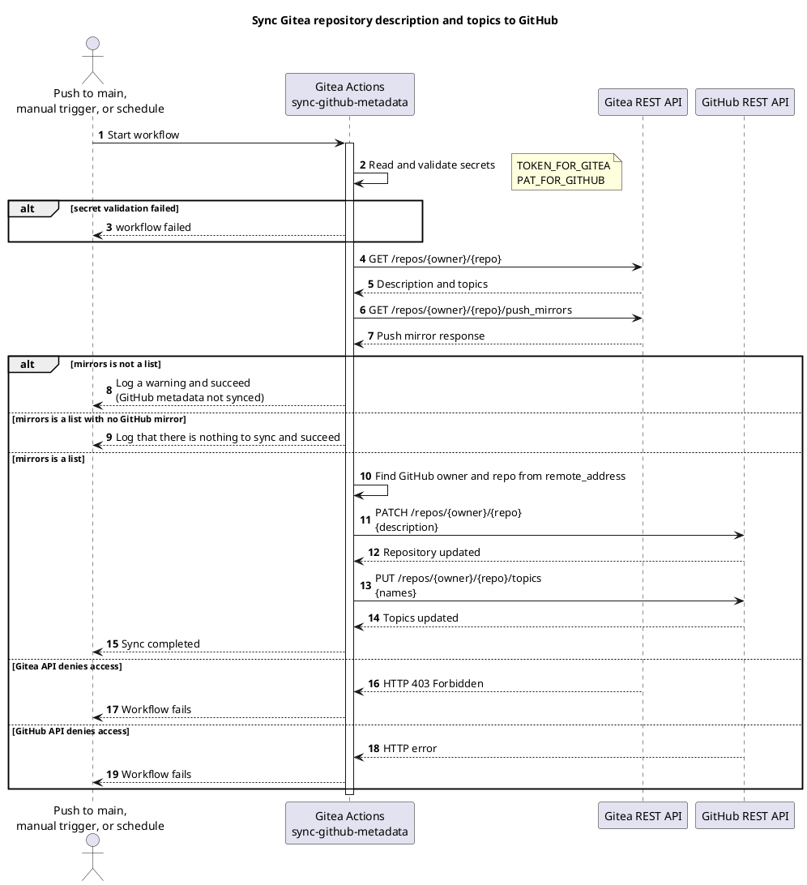
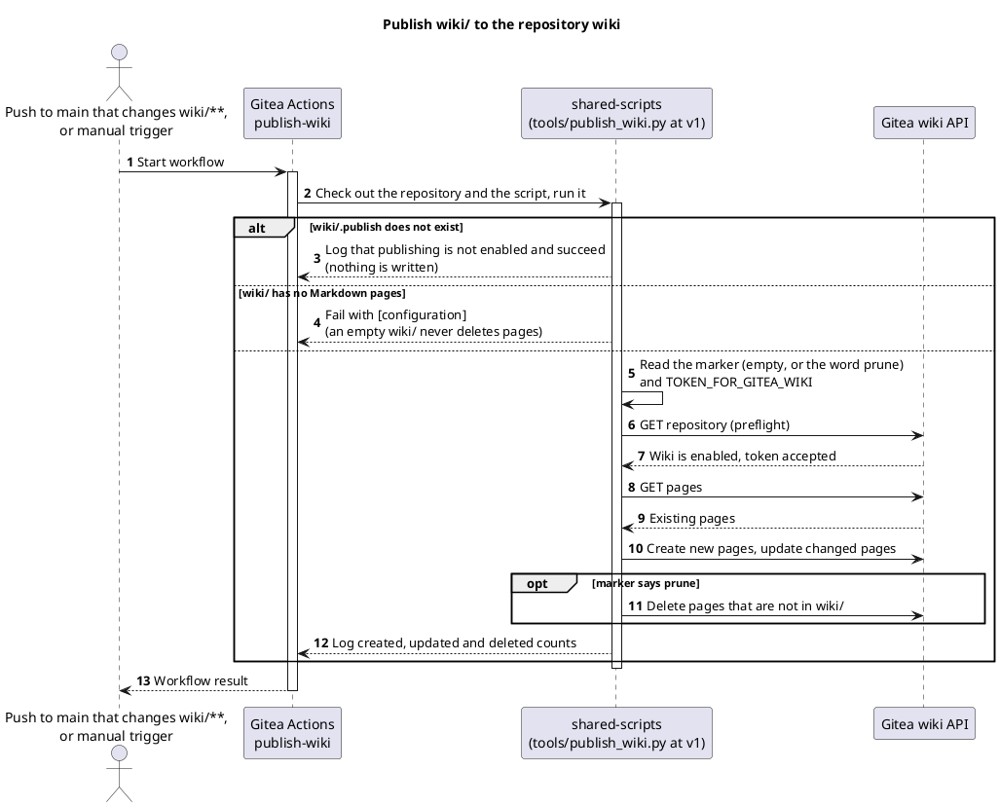
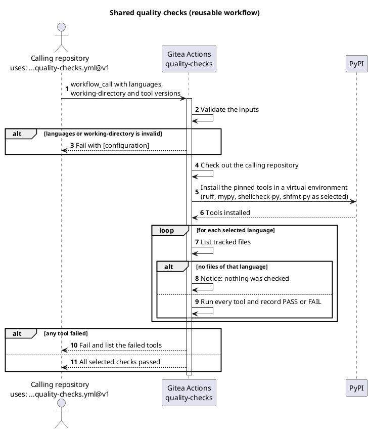
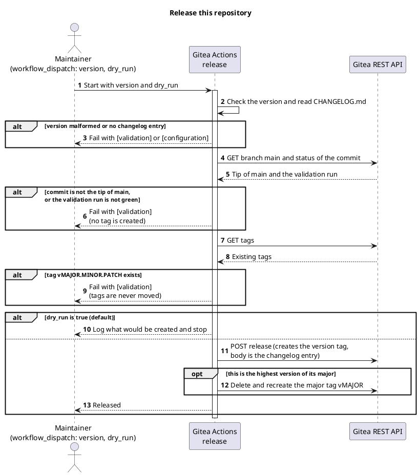
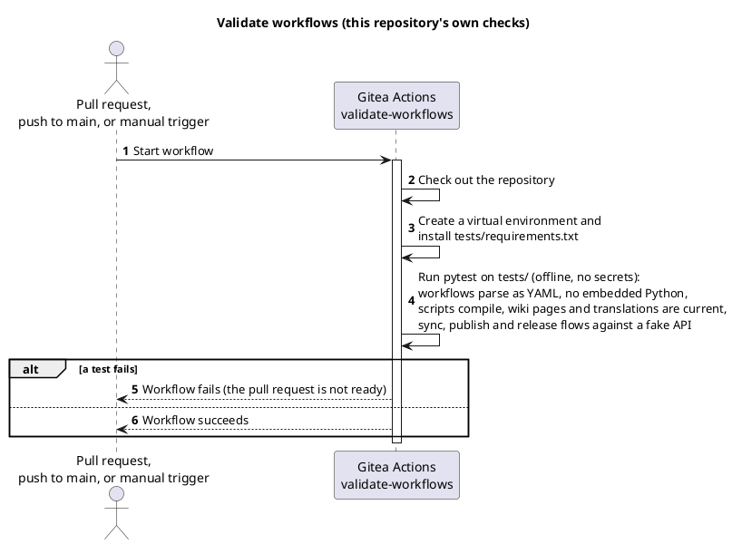

<!-- translation of Home.md, source sha256 8d1f5ed6df38 -->

> Ini ialah terjemahan [`Home`](Home). Halaman bahasa Inggeris ialah teks yang sah, dan perubahan di sini akan ditimpa pada penerbitan wiki yang seterusnya.

[English](Home) | [Dansk](Home.da) | Bahasa Melayu

# TirSystem GitHub Actions

Koleksi aliran kerja (workflow) Gitea Actions yang boleh digunakan semula untuk profesional DevOps dan jurutera perisian yang mengusahakan projek TirSystem.


## Gambaran keseluruhan

Repositori ini ialah koleksi pusat bagi automasi yang boleh digunakan semula untuk repositori TirSystem. Repositori utama berada di `git.tirsystem.com` (Gitea) dan dicerminkan dengan push ke GitHub.

Ia mengandungi lima aliran kerja: penyegerakan metadata ke cermin GitHub, penerbitan wiki, semakan kualiti bersama, aliran kerja keluaran dan pengesahan repositori sendiri. Ia disenaraikan dengan tujuan dan rajah di bawah [Aliran kerja](#aliran-kerja).


## Aliran kerja

Terdapat lima aliran kerja dalam repositori ini. Aliran kerja **scoped** dihantar oleh instans ke setiap repositori organisasi TirSystem dan tidak memerlukan apa-apa dalam repositori; aliran kerja **boleh guna semula** dipanggil oleh sebuah repositori dengan `uses:`; yang lain hanya berjalan di sini. Rajah ialah kod sumber PlantUML dan dalam bahasa Inggeris.

| Aliran kerja | Fail | Jenis | Bermula apabila | Tujuan |
| --- | --- | --- | --- | --- |
| Sync GitHub mirror metadata | [`sync-github-metadata.yml`](https://git.tirsystem.com/TirSystem/github-action/src/branch/main/.gitea/scoped_workflows/sync-github-metadata.yml) | Scoped | push ke `main`, manual, setiap hari 03:17 UTC | Menyalin penerangan dan topik repositori Gitea ke push mirror GitHub-nya |
| Publish wiki | [`publish-wiki.yml`](https://git.tirsystem.com/TirSystem/github-action/src/branch/main/.gitea/scoped_workflows/publish-wiki.yml) | Scoped, pilih menyertai dengan `wiki/.publish` | push ke `main` yang mengubah `wiki/**`, manual | Menerbitkan halaman dalam `wiki/` ke wiki repositori |
| Quality checks | [`quality-checks.yml`](https://git.tirsystem.com/TirSystem/github-action/src/branch/main/.gitea/workflows/quality-checks.yml) | Boleh guna semula (`workflow_call`) | panggilan daripada repositori lain | Menjalankan ruff, mypy, shellcheck dan shfmt pada fail yang dijejaki dan tidak mengubah apa-apa |
| Release | [`release.yml`](https://git.tirsystem.com/TirSystem/github-action/src/branch/main/.gitea/workflows/release.yml) | Repositori ini sahaja | manual | Mencipta tag versi, halaman keluaran dan tag major selepas semakan |
| Validate workflows | [`validate-workflows.yml`](https://git.tirsystem.com/TirSystem/github-action/src/branch/main/.gitea/workflows/validate-workflows.yml) | Repositori ini sahaja | pull request, push ke `main`, manual | Menghurai setiap aliran kerja sebagai YAML dan menjalankan ujian luar talian |

### Menyegerakkan metadata GitHub

Menyegerakkan penerangan dan topik repositori Gitea ke push mirror GitHub.

#### Jadual (cron)

Setiap hari pada 03:17 UTC (`17 3 * * *`), serta pada setiap push ke `main` dan `workflow_dispatch` manual.

#### Aliran kerja



### Menerbitkan wiki

Menerbitkan `wiki/` ke wiki repositori, hanya dalam repositori yang telah menyertai dengan `wiki/.publish`. Perkataan `prune` dalam fail itu juga memadam halaman yang tiada dalam `wiki/`.

#### Aliran kerja



### Semakan kualiti

Aliran kerja boleh guna semula untuk Python dan shell, dipanggil dengan `uses: TirSystem/github-action/.gitea/workflows/quality-checks.yml@v1` (lihat [panduan](QualityChecksPythonShell)).

#### Aliran kerja



### Keluaran

Dimulakan secara manual oleh penyelenggara; dengan `dry_run` `true` (lalai) ia hanya menyemak (lihat [proses keluaran](https://git.tirsystem.com/TirSystem/github-action/src/branch/main/guides/release-process.md)).

#### Aliran kerja



### Mengesahkan aliran kerja

Pengesahan repositori sendiri: ujian luar talian yang menjadi syarat bagi setiap pull request.

#### Aliran kerja




## Keperluan

- Satu instans Gitea dengan Actions diaktifkan dan satu runner yang menyediakan `ubuntu-latest` dengan `python3`
- Satu push mirror GitHub yang dikonfigurasi pada repositori Gitea (paling banyak satu; repositori tanpa cermin dilangkau dengan jayanya)
- Rahsia (secret) repositori:
  - `TOKEN_FOR_GITEA`: token API Gitea (token sahaja, tanpa JSON)
  - `PAT_FOR_GITHUB`: personal access token GitHub yang dibenarkan mengubah suai repositori cermin (token sahaja, tanpa JSON)
  - `TOKEN_FOR_GITEA_WIKI` (hanya untuk repositori yang menerbitkan wiki, lihat [panduan menyertakan repositori](Onboarding.ms)): token Gitea yang boleh menulis ke wiki, disimpan sebagai secret organisasi repositori; tiada sandaran kepada `TOKEN_FOR_GITEA`


## Persediaan

Tiada kebergantungan perlu dipasang; aliran kerja hanya menggunakan pustaka standard Python.

1. Klon repositori:
   ```bash
   git clone ssh://git@git.tirsystem.com:10022/TirSystem/github-action.git
   ```
2. Tambah rahsia yang disenaraikan di bawah [Keperluan](#keperluan) ke tetapan repositori dalam Gitea.
3. Konfigurasikan push mirror GitHub dalam tetapan repositori.


## Jalankan

Aliran kerja berjalan secara automatik pada push ke `main` dan mengikut jadual harian. Untuk menjalankannya secara manual, cetuskan **Sync GitHub mirror metadata** melalui `workflow_dispatch` dari tab Actions dalam Gitea.


## Ujian

Fail aliran kerja dan skrip dalam `tools/` disahkan oleh ujian luar talian yang tidak memerlukan akses rangkaian dan tidak memerlukan rahsia:

```bash
python3 -m venv .venv
source .venv/bin/activate        # Windows PowerShell: .venv\Scripts\Activate.ps1
python -m pip install -r tests/requirements.txt
python -m pytest -q tests
```

Semakan yang sama dijalankan pada setiap pull request dan setiap push ke `main` melalui [`validate-workflows.yml`](https://git.tirsystem.com/TirSystem/github-action/src/branch/main/.gitea/workflows/validate-workflows.yml). Semakan itu menghurai setiap aliran kerja sebagai YAML, memastikan tiada yang menanam Python, mengkompil skrip dalam `tools/`, memerlukan kebenaran kerja yang jelas, dan menguji penghuraian kelayakan (credentials), penghuraian alamat push mirror serta aliran penyegerakan dan penerbitan terhadap API palsu.

Selepas perubahan pada aliran kerja penyegerakan, cetuskan juga **Sync GitHub mirror metadata** secara manual dalam Gitea dan bandingkan penerangan dan topik pada cermin GitHub.
